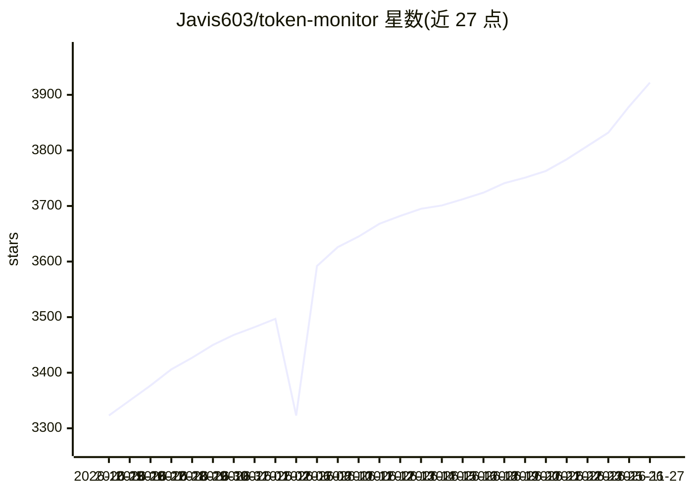

# Javis603/token-monitor

⭐ 3,922 · JavaScript · MIT · 推送 2026-11-26 · [GitHub](https://github.com/Javis603/token-monitor) · [官网](http://javis-ai.com/token-monitor/) · 个人维护 · 中文 README

**给多设备 AI 编码用户的本地令牌用量与额度监控桌面应用**

一个 local-first 的桌面应用，从 56+ AI 编码工具（Claude Code、Codex、Cursor 等）的本地日志中读取 token 用量、账户额度与会话明细，按工具/设备/模型/会话/项目分维度展示，并提供成本换算（多币种）、缓存命中统计与年度趋势看板。多设备间通过 hub（内置于 widget、Node CLI 或 Cloudflare Worker）以 SSE 同步；单设备无需服务端。以 macOS（Homebrew Cask/Releases）、Windows 与 Linux 安装包形式分发，插件 API 处于实验阶段且未沙箱化。

## 筛选速览

| 维度 | 判定 | 备注 |
|---|---|---|
| AI 角色 | `ai-ecosystem` | LLM/agent 周边工具 |
| 许可风险 | `permissive` | MIT |
| 部署形态 | `desktop` | 安装包/桌面程序 |
| 模型依赖 | — | README 未给出锁定关系 |
| 硬件要求 | — | 无带数字的原话,不猜 |
| 安装摩擦 | `low` | 无编译、无系统依赖或容器化 |
| 成熟度 | — | 结构信号不足 |

## 能力要点

- 读取 56+ AI 编码工具的本地日志，展示 token 用量、额度与按 prompt 的会话明细
- 多设备实时同步（SSE hub / iCloud），支持自托管 Worker 与无头 agent
- 额度检测覆盖 provider 的会话/日/周/账单窗口及余额类账户，含 Codex 一键切换与重置预测
- 多种桌面形态：刘海面板、屏幕边缘 dock、菜单栏、浮动气泡、macOS 原生 widget

## 适用场景

- 在多台机器上汇总查看各 AI 编码工具的 token 消耗与额度余量
- 追踪每个项目/模型/会话的成本并导出 CSV 供 Grafana 或表格分析
- 归档旧会话用量，避免工具清理 transcript 后历史丢失

## 场景标签

 · 领域:开发工具/AI 工具用量监控

## 证据(README 行号)

> L20: A desktop app that shows live token usage and AI Tool Limits across 56+ AI coding tools — Claude Code, Codex, Curso
> L113: Most usage monitors are useful on the machine they run on. Token Monitor is built for multi-device work: each devi
> L159: - **Self-hosted sync backend** — in-widget hub, Node CLI hub, or Cloudflare Worker

## 星数曲线

2026-10-25 3,323 → 2026-11-27 3,922（+599）

---
*卡片 v1 · prompt 1.4 · 生成 2026-11-27 · 置信度 low · 依据 README sha `55be9616087c` · [字段定义](../../DATASET.md)*
