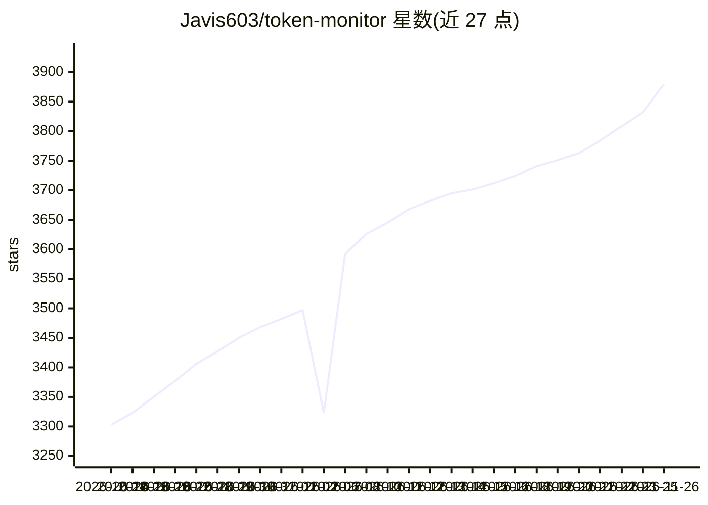

# Javis603/token-monitor

⭐ 3,879 · JavaScript · MIT · 推送 2026-11-25 · [GitHub](https://github.com/Javis603/token-monitor) · [官网](http://javis-ai.com/token-monitor/) · 个人维护 · 中文 README

**监控 56+ AI 编码工具 token 用量与限额的本地桌面组件**

桌面应用，读取本机各 AI 编码工具的本地日志/数据库（如 ~/.claude/projects/、~/.codex/），展示实时 token 用量、成本、账号限额与活动会话，支持按工具、设备、模型、会话、项目细分与历史趋势图。采用 local-first 设计，单设备无需服务器；多设备通过自建 hub（组件内、Node CLI 或 Cloudflare Worker）以 SSE 同步。提供 Homebrew Cask 与 GitHub Releases 安装，支持 macOS/Windows/Linux。

## 筛选速览

| 维度 | 判定 | 备注 |
|---|---|---|
| AI 角色 | `ai-ecosystem` | LLM/agent 周边工具 |
| 许可风险 | `permissive` | MIT |
| 部署形态 | `desktop` | 安装包/桌面程序 |
| 模型依赖 | — | README 未给出锁定关系 |
| 硬件要求 | — | 无带数字的原话,不猜 |
| 安装摩擦 | `low` | 无编译、无系统依赖或容器化 |
| 成熟度 | — | 结构信号不足 |

## 能力要点

- 读取 56+ AI 编码工具的本地日志，秒级刷新 token 用量与限额
- 按工具/设备/模型/会话/项目细分，含缓存命中率与多币种成本
- 多设备同步支持自托管 hub 与无桌面端的无头 agent
- 多样呈现：刘海面板、屏幕边缘停靠、菜单栏、浮动气泡、macOS 原生小组件

## 适用场景

- 同时使用多个 AI 编码工具时集中查看 token 消耗与限额
- 多台机器间同步查看各设备的用量与账户额度
- 导出 CSV/JSON 用量数据到 Grafana 或脚本做分析

## 场景标签

`LLM 可观测性` · 领域:评测与运维

## 证据(README 行号)

> L20: A desktop app that shows live token usage and AI Tool Limits across 56+ AI coding tools — Claude Code, Codex, Curso
> L113: Most usage monitors are useful on the machine they run on. Token Monitor is built for multi-device work: each devi
> L159: - **Self-hosted sync backend** — in-widget hub, Node CLI hub, or Cloudflare Worker

## 星数曲线

2026-10-24 3,303 → 2026-11-26 3,879（+576）

---
*卡片 v1 · prompt 1.4 · 生成 2026-11-26 · 置信度 mid · 依据 README sha `7a4098234429` · [字段定义](../../DATASET.md)*
