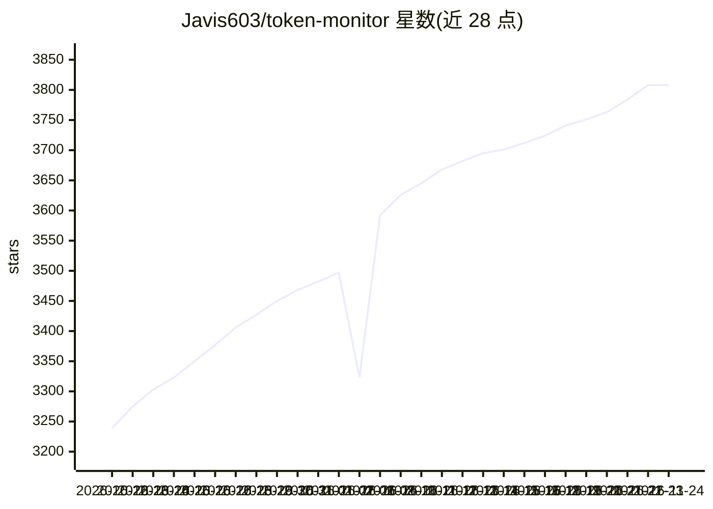

# Javis603/token-monitor

⭐ 3,808 · JavaScript · MIT · 推送 2026-11-22 · [GitHub](https://github.com/Javis603/token-monitor) · [官网](http://javis-ai.com/token-monitor/) · 个人维护 · 中文 README

**面向 AI 编码工具用户的本地 token 用量与费用监控桌面应用**

桌面应用，读取 56+ 个 AI 编码工具（Claude Code、Codex、Cursor 等）在本地的日志与会话文件，汇总 token 用量、费用、配额限制与会话明细，支持按工具、设备、模型、会话或项目拆分展示。单设备本地优先运行无需服务端；多设备同步需自建 hub（Node CLI、Cloudflare Worker 或 iCloud）。安装方式为 Homebrew Cask 或 GitHub Releases 下载，覆盖 Windows/macOS/Linux。

## 筛选速览

| 维度 | 判定 | 备注 |
|---|---|---|
| AI 角色 | `ai-ecosystem` | LLM/agent 周边工具 |
| 许可风险 | `permissive` | MIT |
| 部署形态 | `desktop` | 安装包/桌面程序 |
| 模型依赖 | local-ok | 支持本地模型 |
| 硬件要求 | — | 无带数字的原话,不猜 |
| 安装摩擦 | `low` | 无编译、无系统依赖或容器化 |
| 成熟度 | — | 结构信号不足 |

## 能力要点

- 读取本地日志/SQLite 等数据文件，prompts 与源代码不上传
- 多设备实时同步（SSE hub）与自托管同步后端（Node CLI/Cloudflare Worker）
- 配额限制检测：session/日/周/计费/credits 窗口，含预付余额跟踪
- 多种呈现形态：刘海面板、屏幕边缘 Dock、菜单栏、浮动气泡、macOS 原生小组件

## 适用场景

- 多台设备上统一查看各 AI 编码工具的 token 用量与费用
- 监控各账号的配额窗口与重置时间
- 导出 CSV/JSON 用量数据用于记账或 Grafana 面板

## 场景标签

 · 领域:开发者工具/AI 工具用量监控

## 证据(README 行号)

> L20: A desktop app that shows live token usage and AI Tool Limits across 56+ AI coding tools — Claude Code, Codex, Curso
> L113: Most usage monitors are useful on the machine they run on. Token Monitor is built for multi-device work: each devi
> L154: - **Local-first** — no servers needed for single-device use

## 星数曲线

2026-10-22 3,239 → 2026-11-24 3,808（+569）

---
*卡片 v1 · prompt 1.4 · 生成 2026-11-23 · 置信度 mid · 依据 README sha `38e0051d4e02` · [字段定义](../../DATASET.md)*
