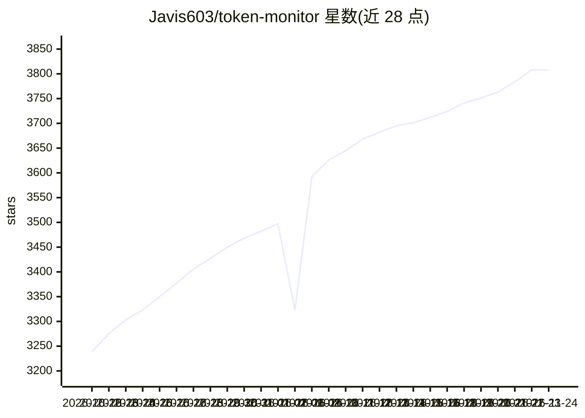

# Javis603/token-monitor

⭐ 3,832 · JavaScript · MIT · 推送 2026-11-23 · [GitHub](https://github.com/Javis603/token-monitor) · [官网](http://javis-ai.com/token-monitor/) · 个人维护 · 中文 README

**桌面小组件：统一追踪 56+ AI 编程工具的 token 用量与额度**

本地优先的桌面应用，通过读取各 AI 编程工具在本机的会话日志与数据库，实时显示 token 用量、费用、额度窗口与会话明细，并按工具、设备、模型、会话、项目维度分解。支持多设备同步（SSE hub、iCloud、Cloudflare Worker、Node CLI hub）、headless agent 上报服务器/WSL 用量、数据导出为 CSV/JSON，以及 macOS 刘海面板、菜单栏、屏幕边缘停靠、浮动气泡、原生小组件等多种展示形态。许可证为 MIT。

## 筛选速览

| 维度 | 判定 | 备注 |
|---|---|---|
| AI 角色 | `ai-enhanced` | 去掉 AI 部分产品仍成立 |
| 许可风险 | `permissive` | MIT |
| 部署形态 | `desktop` | 安装包/桌面程序 |
| 模型依赖 | local-ok | 支持本地模型 |
| 硬件要求 | — | 无带数字的原话,不猜 |
| 安装摩擦 | `low` | 无编译、无系统依赖或容器化 |
| 成熟度 | — | 结构信号不足 |

## 能力要点

- 读取本地日志追踪 56+ 工具的 token 用量、费用与额度，UI 秒级更新
- 按工具/设备/模型/会话/项目多维分解，含缓存命中率与 tok/s 实时速率
- 多设备实时同步，自托管 hub（Node CLI / Cloudflare Worker），单设备无需服务器
- 多种桌面形态：刘海面板、菜单栏布局编辑器、Edge Dock、浮动气泡、macOS 原生小组件

## 适用场景

- 同时使用多个 AI 编程工具时集中查看各账号用量与额度
- 多台设备上的使用记录汇总到同一仪表盘
- 导出 CSV/JSON 到 Grafana/Obsidian 做用量分析
- 记录 AI 订阅费用并与实际用量成本对比

## 场景标签

`LLM 可观测性` · 领域:评测与运维

## 证据(README 行号)

> L20: A desktop app that shows live token usage and AI Tool Limits across 56+ AI coding tools — Claude Code, Codex, Curso
> L113: Most usage monitors are useful on the machine they run on. Token Monitor is built for multi-device work: each devi
> L158: - **Local-first** — no servers needed for single-device use

## 星数曲线

2026-10-22 3,239 → 2026-11-24 3,808（+569）

---
*卡片 v1 · prompt 1.4 · 生成 2026-11-24 · 置信度 mid · 依据 README sha `52fa72ac0bf6` · [字段定义](../../DATASET.md)*
