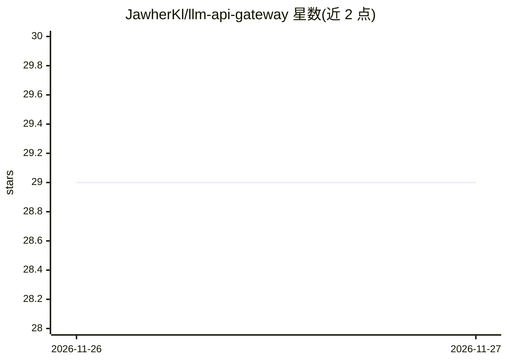

# JawherKl/llm-api-gateway

⭐ 29 · Go · 推送 2026-11-24 · [GitHub](https://github.com/JawherKl/llm-api-gateway) · [官网](https://medium.com/@jawherkl/unified-llm-api-gateway-one-api-to-rule-them-all-f9c585d20923) · 个人维护

**统一多 LLM 后端的可扩展 API 网关**

以 Go/Gin 实现的 API 网关，将 OpenAI、Hugging Face、Groq、Anthropic、Gemini 等多个 LLM 后端的调用聚合到统一 /query 端点，并为每个 provider 提供微服务形式的适配器。内置 Redis 缓存（prompt+参数为键）、按键限流、API key/JWT 认证、JSON 结构化日志、Prometheus 指标，附 Docker Compose 与 Kubernetes 部署清单及 NestJS 管理后台。部分高级功能（配额计费、流式、fallback）仍处于规划阶段。

## 筛选速览

| 维度 | 判定 | 备注 |
|---|---|---|
| AI 角色 | `ai-ecosystem` | LLM/agent 周边工具 |
| 许可风险 | `permissive` | — |
| 部署形态 | `self-host` | docker 或自建部署 |
| 模型依赖 | locked-api |  |
| 硬件要求 | — | 无带数字的原话,不猜 |
| 安装摩擦 | `low` | 无编译、无系统依赖或容器化 |
| 成熟度 | `idea` | |

## 能力要点

- 统一 /query 端点聚合 6 个已接入的 LLM provider
- 每个 provider 以微服务适配器封装，统一内部接口
- Redis 结果缓存与跨实例共享的令牌桶限流
- 提供 Docker 镜像、Kubernetes 清单与 Prometheus 指标端点

## 适用场景

- 为应用提供单一入口访问多家 LLM 服务
- 在网关层统一做认证、限流与用量日志
- 用 Docker Compose 或 K8s 部署生产级 LLM 接入层

## 场景标签

`模型网关` · 领域:Agent 开发

## 证据(README 行号)

> L13: **Unified LLM API Gateway** is a scalable, extensible platform that aggregates and normalises calls to multiple LLM
> L14: It provides a unified API with built-in caching, rate limiting, authentication, logging, metrics, and production-re
> L78: - **Adapters:** Microservices for each provider

## 星数曲线

2026-11-26 29 → 2026-11-27 29（+0）

---
*卡片 v1 · prompt 1.4 · 生成 2026-11-26 · 置信度 high · 依据 README sha `ad4e849b76cd` · [字段定义](../../DATASET.md)*
