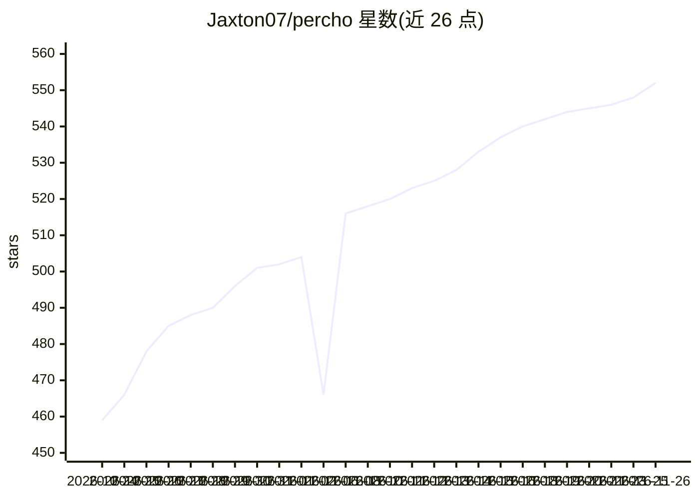

# Jaxton07/percho

⭐ 552 · TypeScript · MIT · 推送 2026-11-24 · [GitHub](https://github.com/Jaxton07/percho) · [官网](https://www.percho.org/) · 个人维护 · 中文 README

**给 Pi coding agent 用的极简桌面 GUI 客户端**

基于 Electron 的桌面图形界面，在主进程嵌入官方 Pi SDK（@earendil-works/pi-coding-agent），与 Pi CLI 共用同一引擎，官方声明非 fork 亦非重新实现。功能覆盖多会话聊天、工具调用的可视化审批（基于 per-tool 规则引擎）、内置子代理与任务并行分发、上下文蒸发压缩旧工具输出、逐轮 diff 侧栏、UI 插件与自定义主题，并支持手机/平板浏览器扫码跨设备查看会话。用户数据独立存放于 ~/.percho/agent/，与 Pi CLI 目录分离且可迁移。

## 筛选速览

| 维度 | 判定 | 备注 |
|---|---|---|
| AI 角色 | `ai-ecosystem` | LLM/agent 周边工具 |
| 许可风险 | `permissive` | MIT |
| 部署形态 | `desktop` | 安装包/桌面程序 |
| 模型依赖 | locked-api |  |
| 硬件要求 | — | 无带数字的原话,不猜 |
| 安装摩擦 | `low` | 无编译、无系统依赖或容器化 |
| 成熟度 | — | 结构信号不足 |

## 能力要点

- 嵌入官方 Pi SDK，与 Pi CLI 运行同一引擎，支持其 TypeScript 扩展、技能与提示模板
- 工具调用可视化审批：底座式逐条批准/拒绝，背后是 per-tool 规则引擎
- 内置子代理（scout 与自定义 agent 定义）与并行任务分发
- 上下文蒸发：过期工具输出压缩为 stub，控制长会话预算

## 适用场景

- 不习惯 TUI、想用图形界面操作 Pi coding agent
- 希望逐条审批工具调用并按规则自动化放行
- 在手机/平板浏览器上远程查看和干预桌面上的编码会话

## 场景标签

`编码 Agent` · 领域:编码与开发

## 证据(README 行号)

> L5:  Highly customizable desktop GUI for the Pi coding agent — the same engine as the Pi CLI, in a clean visual interfac
> L37: Percho embeds the official Pi SDK (`@earendil-works/pi-coding-agent`) in the Electron main process. It is **not a f

## 星数曲线

2026-10-24 459 → 2026-11-26 552（+93）

---
*卡片 v1 · prompt 1.4 · 生成 2026-11-25 · 置信度 high · 依据 README sha `68b00d6f642d` · [字段定义](../../DATASET.md)*
