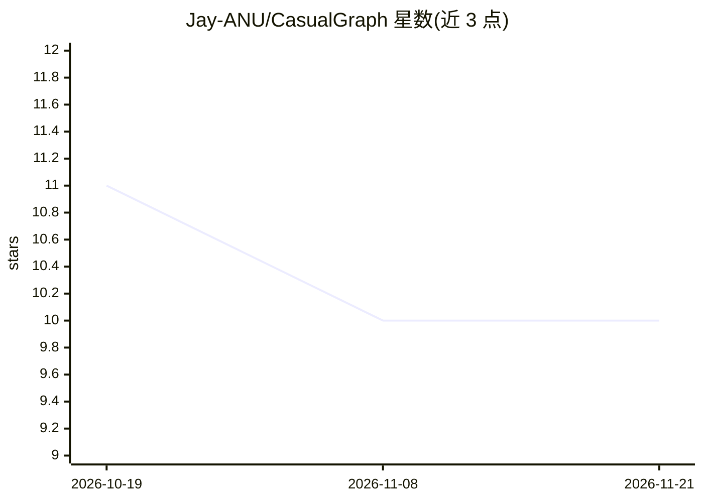

# Jay-ANU/CasualGraph

⭐ 10 · Python · 推送 2026-10-12 · [GitHub](https://github.com/Jay-ANU/CasualGraph) · [官网](https://casualgraphai.vercel.app) · 个人维护

**将 ESG 长报告转为带引用回答与证据图谱的 RAG 应用**

开源 ESG 情报应用：上传 PDF/DOCX/文本报告后切块入库，通过 RAG 问答从检索证据生成带引用的回答，并支持可选 Neo4j 图谱持久化与实体邻域查询。后端 FastAPI、前端 React，检索层提供向量+BM25 混合、多查询扩展、HyDE、重排序等环境变量开关；Redis 保存短期会话与实体上下文。默认模型为 DeepSeek（OpenAI 兼容接口），嵌入用本地 bge-m3 或 DeepInfra。需自行配置嵌入与回答模型的 API key 才能实际使用。

## 筛选速览

| 维度 | 判定 | 备注 |
|---|---|---|
| AI 角色 | `ai-native` | 本体是模型或模型工具 |
| 许可风险 | `none` | — |
| 部署形态 | `self-host` | docker 或自建部署 |
| 模型依赖 | locked-api |  |
| 硬件要求 | — | 无带数字的原话,不猜 |
| 安装摩擦 | `low` | 无编译、无系统依赖或容器化 |
| 成熟度 | `idea` | |

## 能力要点

- 带引用的 RAG 问答，回答附检索片段与图谱证据
- 混合检索控制：向量+BM25 RRF 融合、多查询、HyDE、重排序均为环境开关
- Fast/Deep 两档推理（Deep 启用 thinking），默认 DeepSeek V4 Pro
- Redis 会话记忆与实体感知的文档作用域

## 适用场景

- 把企业 ESG/可持续披露报告变成可提问的证据库
- 对报告问答结果需要附带出处引用的场景
- 本地部署一套可调检索策略的 RAG 流水线
- 审计与评审回答所依据的实体关系图谱

## 场景标签

`RAG` `文档问答` · 领域:知识与检索

## 证据(README 行号)

> L10: CausalGraph AI is an open-source ESG intelligence application for turning long-form corporate reports into searchab
> L19: - Retrieval-augmented chat: answer questions from retrieved report evidence instead of unconstrained model memory.
> L22: - Fast / Deep reasoning tiers: both default to DeepSeek V4 Pro over its OpenAI-compatible API; Fast disables thinki

## 星数曲线

2026-10-19 11 → 2026-11-21 10（-1）

---
*卡片 v1 · prompt 1.4 · 生成 2026-11-20 · 置信度 mid · 依据 README sha `e5581cb03d9e` · [字段定义](../../DATASET.md)*
