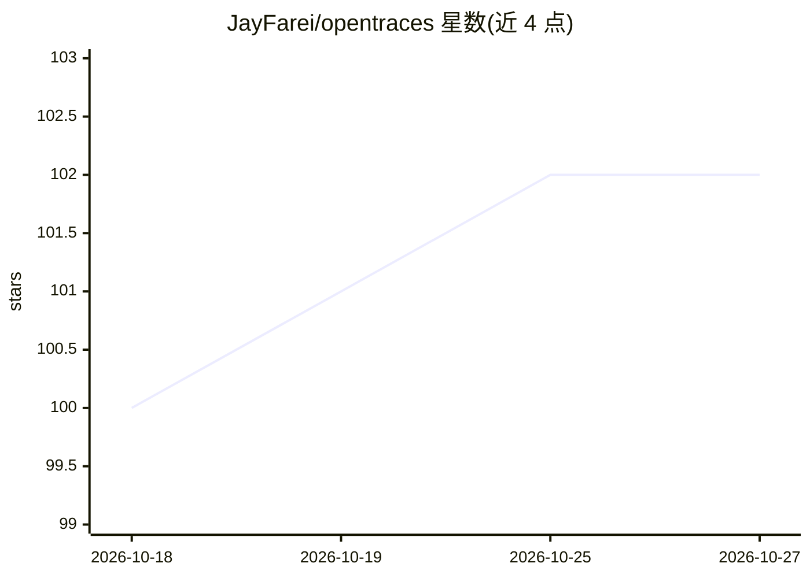

# JayFarei/opentraces

⭐ 102 · Python · NOASSERTION · 推送 2026-10-13 · [GitHub](https://github.com/JayFarei/opentraces) · [官网](https://www.opentraces.ai/) · 个人维护

**本地优先的 agent 工作证据层：捕获代理所见/所做/所改**

开源 schema + CLI，通过 session hooks 与 harness 扩展从 Claude Code、Codex CLI、Pi 捕获编码 agent 的操作轨迹，存入本地私有 bucket（trace.json、补丁历史、内容寻址 blob），并把补丁锚定到接受它的 Git 提交（Trace Trails blame/graph/track）。Context Tree 可重建每步模型可见内容。workflow 可把轨迹投影为可审查的 HuggingFace 数据集行，发布前运行安全检测工具。默认本地存储，同步 HF 远端需显式 opt-in。提供 pipx/brew/源码安装与对称的 uninstall 命令。

## 筛选速览

| 维度 | 判定 | 备注 |
|---|---|---|
| AI 角色 | `ai-ecosystem` | LLM/agent 周边工具 |
| 许可风险 | `none` | NOASSERTION |
| 部署形态 | `library` | 以包/库形式分发 |
| 模型依赖 | — | README 未给出锁定关系 |
| 硬件要求 | — | 无带数字的原话,不猜 |
| 安装摩擦 | `low` | 无编译、无系统依赖或容器化 |
| 成熟度 | `idea` | |

## 能力要点

- Trace/Trail/Ctx 三记录结构：做了什么、改了什么并是否存活、模型看到什么
- 补丁与 Git 提交关联（post-commit hook + refs/notes），支持 blame/graph/track
- 轨迹经 workflow 投影为数据集行，发布前运行安全检测器
- 支持 Claude Code、Codex CLI、Pi 三类 agent 的捕获钩子，附 OTLP 可选接收器

## 适用场景

- 为编码 agent 会话留存完整证据，事后可搜索与切片
- 把 PR 提交回溯到产生它的会话，生成意图说明
- 从历史轨迹提取训练/评测数据集并发布到 HuggingFace
- 生成每日站会报告、故障胶囊与告警（上下文浪费、失败率等）

## 场景标签

`LLM 可观测性` · 领域:评测与运维

## 证据(README 行号)

> L13: **Traces are the new source code.** opentraces is a local-first evidence layer for agent work — an open schema + CL
> L23: 1. Capture traces from supported agents (Claude Code, Codex CLI, and Pi) via session hooks and harness extensions.
> L26: 4. Correlate trace patches to Git history via Trace Trails: blame, graph, and track.

## 星数曲线

2026-10-18 100 → 2026-10-27 102（+2）

---
*卡片 v1 · prompt 1.4 · 生成 2026-10-23 · 置信度 mid · 依据 README sha `3b0a75cb53a6` · [字段定义](../../DATASET.md)*
