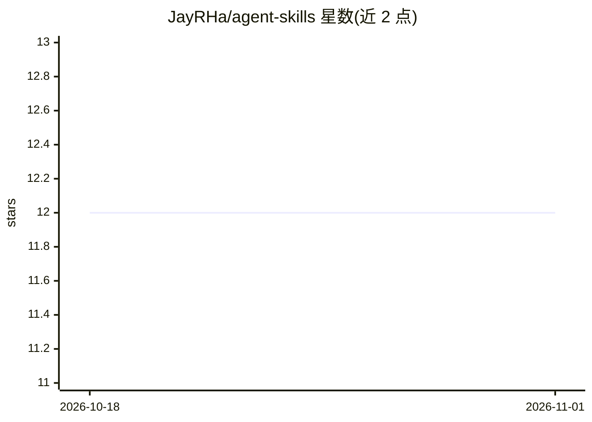

# JayRHa/agent-skills

⭐ 12 · Python · MIT · 推送 2026-10-14 · [GitHub](https://github.com/JayRHa/agent-skills) · 个人维护

**面向编码 agent 的技能合集：74 个 SKILL.md 即插即用包**

社区维护的 Agent Skills 集合，共 74 个技能、10 个类别、460 个文件。每个技能是含 SKILL.md（指令+使用时机）及参考、可运行脚本、示例与模板的自包含文件夹，覆盖代码审查、Terraform、威胁建模、SQL 优化、技术写作、OKR 等场景。兼容 Claude Code、Claude 应用、Codex、Gemini CLI、Cursor 等 agent，按描述自动发现、用到时才加载。通过 git clone 后复制技能目录安装。

## 筛选速览

| 维度 | 判定 | 备注 |
|---|---|---|
| AI 角色 | `ai-knowledge` | 知识聚合/清单类 |
| 许可风险 | `permissive` | MIT |
| 部署形态 | `self-host` | docker 或自建部署 |
| 模型依赖 | — | README 未给出锁定关系 |
| 硬件要求 | — | 无带数字的原话,不猜 |
| 安装摩擦 | `low` | 无编译、无系统依赖或容器化 |
| 成熟度 | — | 结构信号不足 |

## 能力要点

- 74 个技能按 10 个类别组织，自包含文件夹形式
- 兼容 Claude Code、Codex、Gemini CLI、Cursor 等 agent 自动发现加载
- 每个技能含指令、参考、可运行脚本、示例与模板

## 适用场景

- 为编码 agent 增加代码审查、单元测试编写等工程能力
- 为 agent 配置 DevOps、数据处理、写作等场景技能
- 浏览目录挑选技能复制到自己的 .claude/skills/ 目录

## 场景标签

`精选清单` `提示工程` · 领域:Agent 开发

## 证据(README 行号)

> L16: A collection of Agent Skills with instructions, scripts, references and examples for coding agents.
> L20: `74 Skills` · `10 Categories` · `460 Files` · `Open Standard` · `Community Maintained`
> L22: This repository is a growing library of Agent Skills. Each skill is a self-contained folder with a `SKILL.md` (inst

## 星数曲线

2026-10-18 12 → 2026-11-01 12（+0）

---
*卡片 v1 · prompt 1.4 · 生成 2026-11-01 · 置信度 mid · 依据 README sha `a5fbce05aa55` · [字段定义](../../DATASET.md)*
