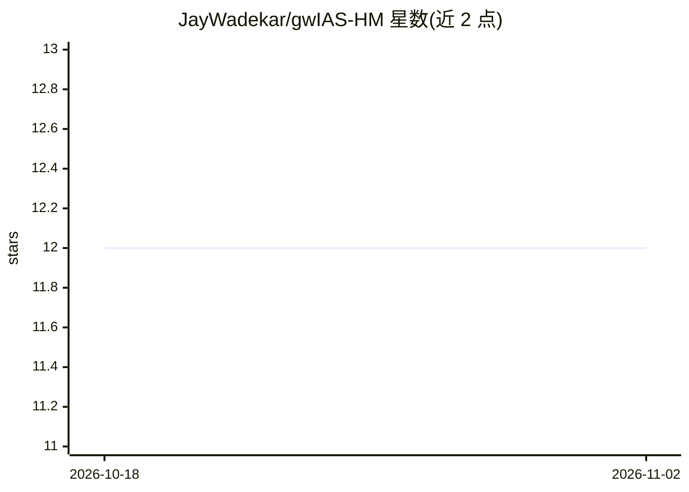

# JayWadekar/gwIAS-HM

⭐ 12 · Jupyter Notebook · MIT · 推送 2026-02-19 · [GitHub](https://github.com/JayWadekar/gwIAS-HM) · [官网](https://jaywadekar.github.io/gwIAS-HM/) · 组织维护

**含高阶谐波的引力波搜索流水线（科研代码）**

IAS 引力波研究组开发的搜索流水线，将高阶模式（HM）谐波纳入模板库，采用逐模匹配滤波以控制计算成本与灵敏度损失。提供 6 个教程 notebook，覆盖模板库构建、用 normalizing flows 生成天体物理先验、触发与符合模块、候选排序与 FAR 计算、p_astro 与探测表，可在公开 LVK 应变数据上复现结果；另部署了 LLM 聊天机器人帮助理解流水线。依赖 numpy/scipy/gsl/lal/lalsimulation 等，pytorch 等为可选；README 自述代码仍在清理、部分功能硬编码（双探测器、三种模式）。

## 筛选速览

| 维度 | 判定 | 备注 |
|---|---|---|
| AI 角色 | `ai-native` | 本体是模型或模型工具 |
| 许可风险 | `permissive` | MIT |
| 部署形态 | `None` |  |
| 模型依赖 | — | README 未给出锁定关系 |
| 硬件要求 | — | 无带数字的原话,不猜 |
| 安装摩擦 | `low` | 无编译、无系统依赖或容器化 |
| 成熟度 | `idea` | |

## 能力要点

- 逐模匹配滤波将高阶谐波纳入模板库
- 6 个可复现教程 notebook，运行于公开 LVK 观测数据
- 用 normalizing flows 生成模板与 HM 振幅比的天体物理先验
- 候选排序、FAR 与 p_astro 计算模块

## 适用场景

- 在 LVK 公开应变数据上复现含高阶谐波的引力波搜索
- 学习模板库构建、匹配滤波与符合分析流程
- 研究高阶模式对引力波搜索灵敏度的影响

## 场景标签

`科研工具` `教程课程` · 领域:学习与行业

## 证据(README 行号)

> L3: `IAS-HM` is a new search pipeline including higher modes (HM) or harmonics in the template bank waveforms. Nearly al
> L15: 2. Astrophysical_prior.ipynb: Generate astrophysical prior for templates and HM mode amplitude ratios using normali
> L17: 3. Trig_Coin_test_with_injection.ipynb: Using individual injections, we test the triggering module (for data pre-pr

## 星数曲线

2026-10-18 12 → 2026-11-02 12（+0）

---
*卡片 v1 · prompt 1.4 · 生成 2026-11-01 · 置信度 high · 依据 README sha `2be532fbca43` · [字段定义](../../DATASET.md)*
