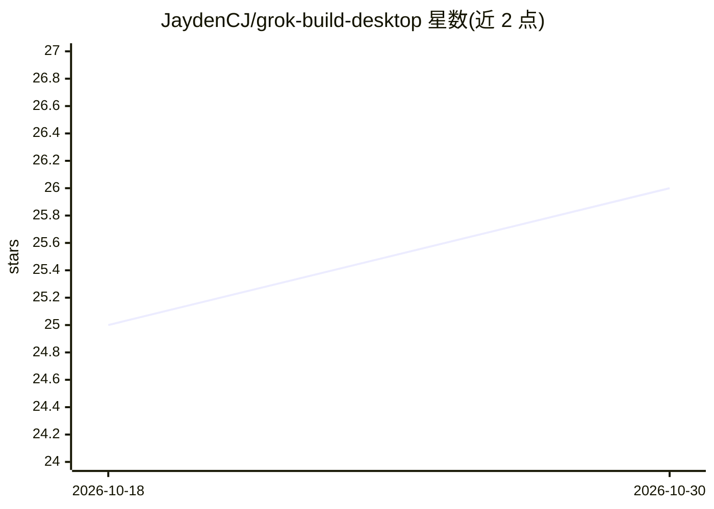

# JaydenCJ/grok-build-desktop

⭐ 26 · TypeScript · NOASSERTION · 推送 2026-07-16 · [GitHub](https://github.com/JaydenCJ/grok-build-desktop) · 个人维护 · 中文 README

**Grok CLI 的原生桌面客户端：流式对话、会话与 MCP/Skills 管理**

基于 Tauri 2 + React 19 + Rust 的桌面应用，把 xAI 官方 Grok Build CLI 从终端使用转为图形界面。提供 Grok Chat 与 Grok Code 两种模式，UI 仅暴露 Grok 模型路径，模型列表反映本机 Grok CLI 的声明。功能含非阻塞流式输出、SQLite 持久化的 FIFO 运行队列、会话历史、MCP 服务器与 Skills（SKILL.md）管理、Prompt 模板库与能力检查器。macOS Apple Silicon 提供预构建包，Windows/Intel 需从源码构建；需已安装并登录的 Grok CLI。仓库为 source-available（all rights reserved），非开源许可。

## 筛选速览

| 维度 | 判定 | 备注 |
|---|---|---|
| AI 角色 | `ai-ecosystem` | LLM/agent 周边工具 |
| 许可风险 | `none` | NOASSERTION |
| 部署形态 | `library` | 以包/库形式分发 |
| 模型依赖 | locked-api |  |
| 硬件要求 | — | 无带数字的原话,不猜 |
| 安装摩擦 | `low` | 无编译、无系统依赖或容器化 |
| 成熟度 | — | 结构信号不足 |

## 能力要点

- 通过 streaming-json 与 Rust 队列实现非阻塞流式 UI
- FIFO 运行队列与对话历史 SQLite 持久化
- MCP 服务器目录与精选编程技能一键安装到 ~/.grok/skills
- Prompt 模板库与 Context/Skills/MCP 能力检查器

## 适用场景

- 在桌面窗口中以流式方式与 Grok 进行编程问答与代码实现
- 管理社区 MCP 服务器与编程技能供 Grok CLI 使用
- 维护可复用的 Prompt 模板与会话历史

## 场景标签

`AI 助手` · 领域:对话与助手

## 证据(README 行号)

> L3: ### A native desktop app for xAI's Grok CLI — a calm, Claude-Desktop-style home for coding with Grok.
> L52: - **Grok Build CLI** installed and logged in (`grok login`) — the primary runner

## 星数曲线

2026-10-18 25 → 2026-10-30 26（+1）

---
*卡片 v1 · prompt 1.4 · 生成 2026-10-27 · 置信度 high · 依据 README sha `c8ab9e2afa0c` · [字段定义](../../DATASET.md)*
