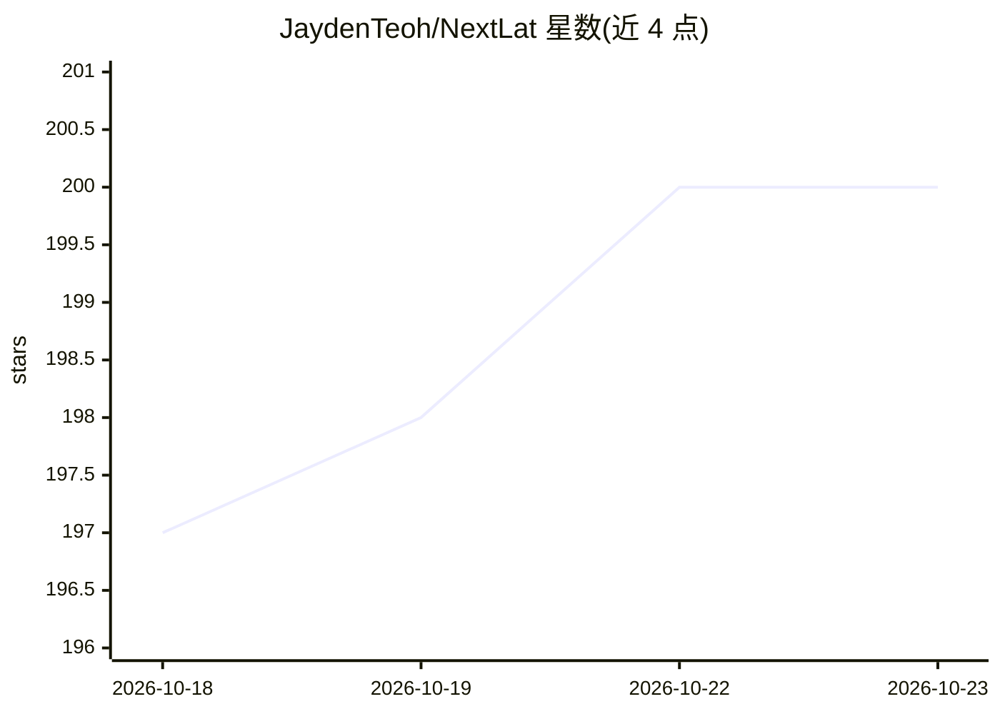

# JaydenTeoh/NextLat

⭐ 200 · Python · MIT · 推送 2026-06-12 · [GitHub](https://github.com/JaydenTeoh/NextLat) · [官网](https://jaydenteoh.github.io/blog/2026/nextlat) · 个人维护

**Next-Latent Prediction Transformer 论文官方训练代码库**

论文《Next-Latent Prediction Transformers Learn Compact World Models》的官方代码库，提供 NextLat 及 GPT/MTP/JTP/BST 等基线算法的实现，覆盖 Path-Star、Countdown、Manhattan Taxi Rides、TinyStories、FineWeb-Edu 等基准的训练与评估脚本，支持单卡与 DDP 多卡训练（PyTorch Lightning Fabric），指标记录到 Weights & Biases 与 CSV。限制：需 PyTorch 2.6+（Muon 优化器需 2.9+），实验结果在 NVIDIA RTX A5000/H100 NVL/B200 GPU 上产生。

## 筛选速览

| 维度 | 判定 | 备注 |
|---|---|---|
| AI 角色 | `ai-native` | 本体是模型或模型工具 |
| 许可风险 | `permissive` | MIT |
| 部署形态 | `library` | 以包/库形式分发 |
| 模型依赖 | — | README 未给出锁定关系 |
| 硬件要求 | — | 无带数字的原话,不猜 |
| 安装摩擦 | `low` | 无编译、无系统依赖或容器化 |
| 成熟度 | — | 结构信号不足 |

## 能力要点

- NextLat 与 4 种基线算法实现（GPT/MTP/JTP/BST）
- YAML 配置含论文精确超参，支持 seed 网格扫描
- 单卡与 Lightning Fabric DDP 多卡训练
- Manhattan 世界模型可视化、线性探针、自投机解码等评估脚本

## 适用场景

- 复现论文实验结果
- 对比 next-token 与 next-latent 预测算法
- 基于 NextLat 改进自己的序列建模研究

## 场景标签

`模型训练` · 领域:训练与推理

## 证据(README 行号)

> L7:  Official codebase for Next-Latent Prediction Transformers Learn Compact World Models
> L27: |model_nextlat.py|Next-Latent Prediction (NextLat)|

## 星数曲线

2026-10-18 197 → 2026-10-23 200（+3）

---
*卡片 v1 · prompt 1.4 · 生成 2026-10-22 · 置信度 high · 依据 README sha `ae10865aae1d` · [字段定义](../../DATASET.md)*
