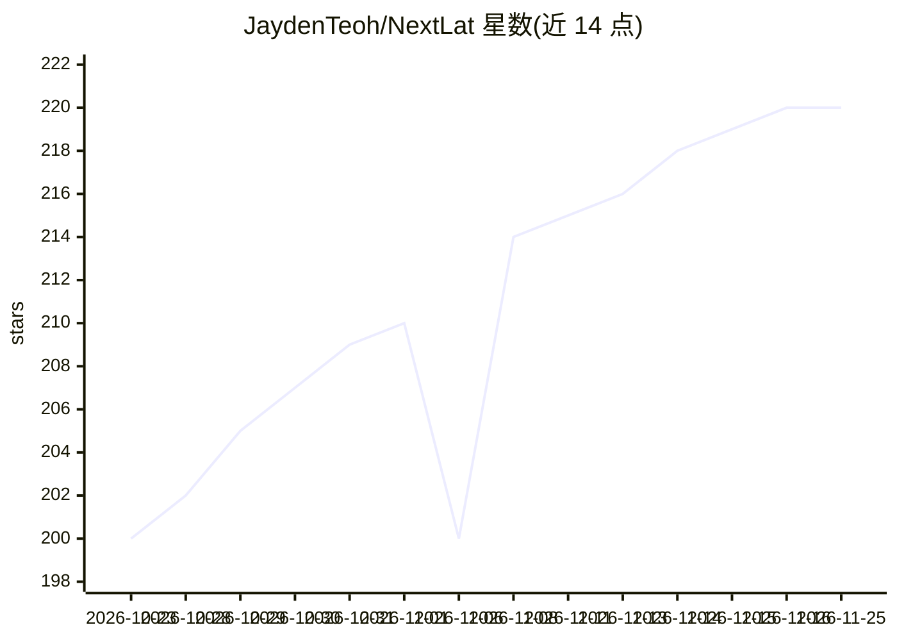

# JaydenTeoh/NextLat

⭐ 220 · Python · MIT · 推送 2026-11-21 · [GitHub](https://github.com/JaydenTeoh/NextLat) · [官网](https://jaydenteoh.github.io/blog/2026/nextlat) · 个人维护

**NextLat 论文官方代码库：复现世界模型训练实验**

论文《Next-Latent Prediction Transformers Learn Compact World Models》的官方实现，提供 NextLat 及 GPT、MTP、JTP、BST 等 baseline 算法代码，覆盖 Path-Star、Countdown、Manhattan Taxi Rides、TinyStories、FineWeb-Edu 五个基准。支持单卡与 Lightning Fabric 多卡训练，YAML 配置记录论文复现所需超参数，脚本目录含每个算法与基准的现成训练脚本。要求 PyTorch ≥2.6（Muon 优化器需 ≥2.9），文档提示 torch.compile 在数值敏感基准与 Hopper GPU 上可能产生不一致结果。

## 筛选速览

| 维度 | 判定 | 备注 |
|---|---|---|
| AI 角色 | `ai-native` | 本体是模型或模型工具 |
| 许可风险 | `permissive` | MIT |
| 部署形态 | `library` | 以包/库形式分发 |
| 模型依赖 | — | README 未给出锁定关系 |
| 硬件要求 | — | 无带数字的原话,不猜 |
| 安装摩擦 | `low` | 无编译、无系统依赖或容器化 |
| 成熟度 | — | 结构信号不足 |

## 能力要点

- NextLat 与 4 种 baseline（GPT/MTP/JTP/BST）统一实现于 models/ 目录
- YAML 配置含论文实验的超参数，支持多 seed 与网格搜索
- 单 GPU 与 Lightning Fabric DDP 多 GPU 训练脚本
- 含 Manhattan 世界模型可视化与 TinyStories 线性探针评估脚本

## 适用场景

- 复现论文中各基准的实验结果
- 对比 next-latent 与 next-token 等预测目标
- 研究潜在预测对模型内部世界模型的影响

## 场景标签

`模型训练` · 领域:训练与推理

## 证据(README 行号)

> L7:  Official codebase for Next-Latent Prediction Transformers Learn Compact World Models
> L23: The code for NextLat and all baseline algorithms can be found in the `models/` folder:

## 星数曲线

2026-10-23 200 → 2026-11-25 220（+20）

---
*卡片 v1 · prompt 1.4 · 生成 2026-11-25 · 置信度 high · 依据 README sha `e1114df7d966` · [字段定义](../../DATASET.md)*
