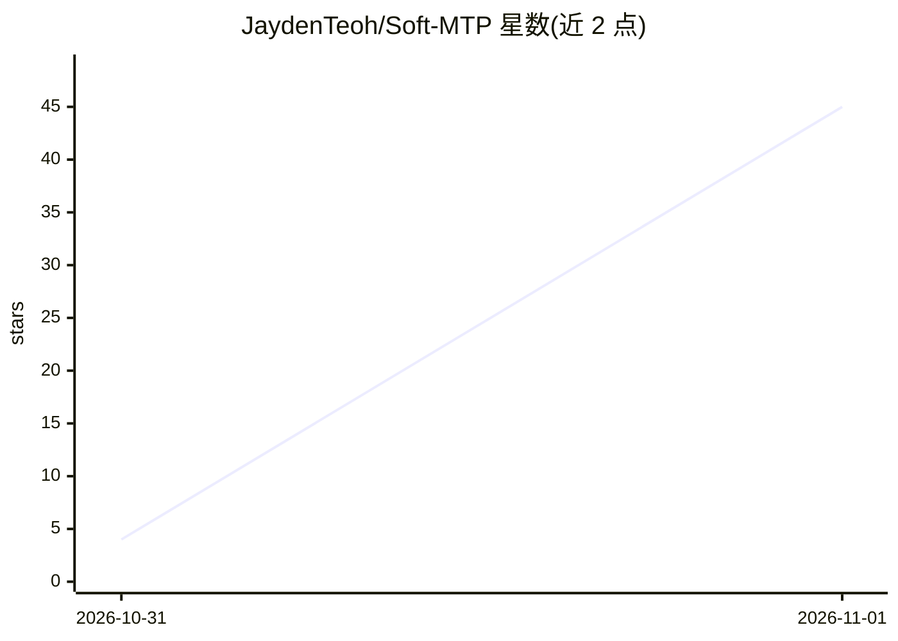

# JaydenTeoh/Soft-MTP

⭐ 45 · Python · MIT · 推送 2026-10-30 · [GitHub](https://github.com/JaydenTeoh/Soft-MTP) · [官网](https://arxiv.org/abs/2610.38331) · 个人维护

**多 token 预测训练方法（Soft-MTP）官方代码库**

论文 Multi-Token Prediction Done Right 的官方实现：提供 Soft-MTP 目标函数（含 KL 梯度恢复技巧）、标准 MTP、直接 KL 与 NTP 四种训练目标，基于 FineWeb-Edu 数据训练 167M–1.2B 四档模型。附带 Hugging Face 预训练检查点（含 MTP 头用于自投机解码）、lm-evaluation-harness 下游评测与投机解码评测脚本。训练需 PyTorch 2.9+（Muon 优化器）、多 GPU torchrun，默认数据下载约 120GB 磁盘。MIT 许可。

## 筛选速览

| 维度 | 判定 | 备注 |
|---|---|---|
| AI 角色 | `ai-native` | 本体是模型或模型工具 |
| 许可风险 | `permissive` | MIT |
| 部署形态 | `library` | 以包/库形式分发 |
| 模型依赖 | — | README 未给出锁定关系 |
| 硬件要求 | — | 无带数字的原话,不猜 |
| 安装摩擦 | `low` | 无编译、无系统依赖或容器化 |
| 成熟度 | — | 结构信号不足 |

## 能力要点

- 四种可切换训练目标：soft_mtp / hard_mtp / direct_kl / ntp
- KL 梯度恢复技巧，pytest 验证与显式 KL 最小化梯度一致
- Hugging Face 提供 167M–1.2B 预训练检查点，含 MTP 头用于自投机解码
- 投机解码评测：tok/fwd、per-head acceptance、speedup 等指标

## 适用场景

- 复现论文中的 Soft-MTP 训练与评测
- 研究多 token 预测目标对语言模型预训练的影响
- 加载检查点进行自投机解码实验

## 场景标签

`模型训练` · 领域:训练与推理

## 证据(README 行号)

> L7:  Official codebase for Multi-Token Prediction Done Right
> L30: The models from the paper for NTP, MTP and Soft-MTP objectives are available on the
> L110: python -m src.eval_spec --ckpts output/167m_fineweb_soft_mtp/checkpoint-60000 \

## 星数曲线

2026-10-31 4 → 2026-11-01 45（+41）

---
*卡片 v1 · prompt 1.4 · 生成 2026-10-31 · 置信度 mid · 依据 README sha `83975f0a274d` · [字段定义](../../DATASET.md)*
