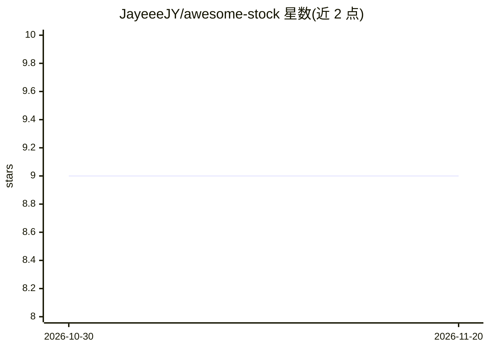

# JayeeeJY/awesome-stock

⭐ 9 · Python · AGPL-3.0 · 推送 2026-11-08 · [GitHub](https://github.com/JayeeeJY/awesome-stock) · [官网](https://github.com/JayeeeJY/awesome-stock/releases/latest) · 个人维护 · 中文 README

**个人投资者的 AI 投资复盘工作台：记录决策依据并复盘**

本地优先的个人投资工作台，覆盖资产记录、研究证据保存、执行计划、实际成交关联与决策复盘的完整流程。AI 部分（Ask Awesome）作为助手帮助梳理材料、找证据缺口，用户可接 DeepSeek/OpenAI API Key 或本地 Ollama，也可完全不配模型独立使用；发送内容由用户确认，不自动下单。原生安装在 macOS Apple Silicon 上验证，Docker 支持 Linux/Windows/macOS，数据默认保存在本机。当前不支持券商同步、自动下单、空头或期权记账。

## 筛选速览

| 维度 | 判定 | 备注 |
|---|---|---|
| AI 角色 | `ai-enhanced` | 去掉 AI 部分产品仍成立 |
| 许可风险 | `dual` | AGPL-3.0 |
| 部署形态 | `self-host` | docker 或自建部署 |
| 模型依赖 | local-ok | 支持本地模型 |
| 硬件要求 | — | 无带数字的原话,不猜 |
| 安装摩擦 | `low` | 无编译、无系统依赖或容器化 |
| 成熟度 | — | 结构信号不足 |

## 能力要点

- 多账户多币种持仓与成交记录，数据默认保存在本机
- 研究笔记保留支持/反方证据与失效条件及历史版本
- Ask Awesome 助手：可接 DeepSeek/OpenAI/本地 Ollama，不配 API 也可用
- 决策复盘区分「是否按计划执行」与「结果好坏」

## 适用场景

- 记录每笔交易的依据，避免事后想不起为什么买
- 把研究证据、投资判断与执行计划串联成可核对的流程
- 让 AI 协助梳理本地投资材料而不自动替你决策

## 场景标签

`AI 助手` `金融量化` · 领域:对话与助手

## 证据(README 行号)

> L24: - 🤖 **AI 只当助手**：Ask Awesome 帮你理解材料、找证据缺口；发送什么内容由你确认，不自动下单
> L116: 模型是可选连接，账本、研究、计划与复盘可以独立使用。数据默认保存在本机；只有你确认发送的内容会交给所配置的模型服务。
> L130: 没有默认账号密码。原生安装目前在 macOS Apple Silicon 上验证。Docker 可以在 Linux、Windows 和 macOS 上跑同一套本地服务，见上文，仍是实验支持。Intel Mac 原生安装和独立移动

## 星数曲线

2026-10-30 9 → 2026-11-20 9（+0）

---
*卡片 v1 · prompt 1.4 · 生成 2026-11-20 · 置信度 high · 依据 README sha `fd9024e63946` · [字段定义](../../DATASET.md)*
