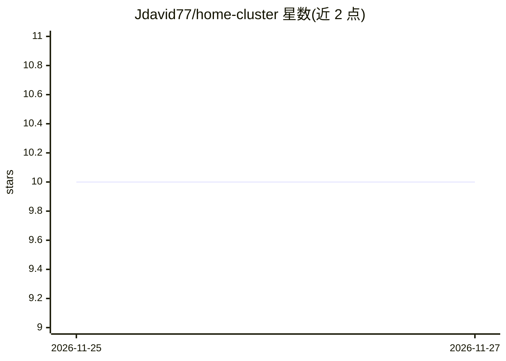

# Jdavid77/home-cluster

⭐ 10 · HCL · MIT · 推送 2026-11-26 · [GitHub](https://github.com/Jdavid77/home-cluster) · [官网](https://live.jnobrega.com) · 个人维护

**个人家庭 Kubernetes 集群的 GitOps 配置仓库**

作者个人家庭实验室的基础设施即代码仓库：7 节点裸金属 Kubernetes 集群运行 Talos OS，通过 Flux 从本仓库持续调和集群状态，Renovate 自动化依赖更新，Terraform 置备外部依赖（Akeyless、Authentik、Garage）。README 记录拓扑、硬件清单、网络（Cilium/Cloudflare Tunnel/Tailscale）、存储（Longhorn/Volsync）、安全与可观测性组件，仓库内含 .claude/skills 目录存放 Claude Code 技能用于仓库维护工作流。

## 筛选速览

| 维度 | 判定 | 备注 |
|---|---|---|
| AI 角色 | `ai-enhanced` | 去掉 AI 部分产品仍成立 |
| 许可风险 | `permissive` | MIT |
| 部署形态 | `self-host` | docker 或自建部署 |
| 模型依赖 | — | README 未给出锁定关系 |
| 硬件要求 | — | 无带数字的原话,不猜 |
| 安装摩擦 | `low` | 无编译、无系统依赖或容器化 |
| 成熟度 | — | 结构信号不足 |

## 能力要点

- Talos OS + Flux + Renovate 的全 GitOps 集群管理
- 7 节点裸金属硬件清单与 mermaid 拓扑图
- Cloudflare Tunnel 公网访问、无端口转发
- Volsync 备份到集群内 Garage 与 Cloudflare R2 异地

## 适用场景

- 参考搭建基于 Talos 与 Flux 的家庭 Kubernetes 集群
- 查找家庭自托管服务的网络与备份方案
- 在 kubesearch 上寻找可部署的应用灵感

## 场景标签

 · 领域:基础设施/DevOps

## 证据(README 行号)

> L15: This repository contains the configuration for my home Kubernetes cluster — a 7-node bare-metal setup running on Ta
> L27: └── 📁 skills           # reusable Claude Code skills (commit, lint, create-app...)

## 星数曲线

2026-11-25 10 → 2026-11-27 10（+0）

---
*卡片 v1 · prompt 1.4 · 生成 2026-11-24 · 置信度 low · 依据 README sha `dec6831e4886` · [字段定义](../../DATASET.md)*
