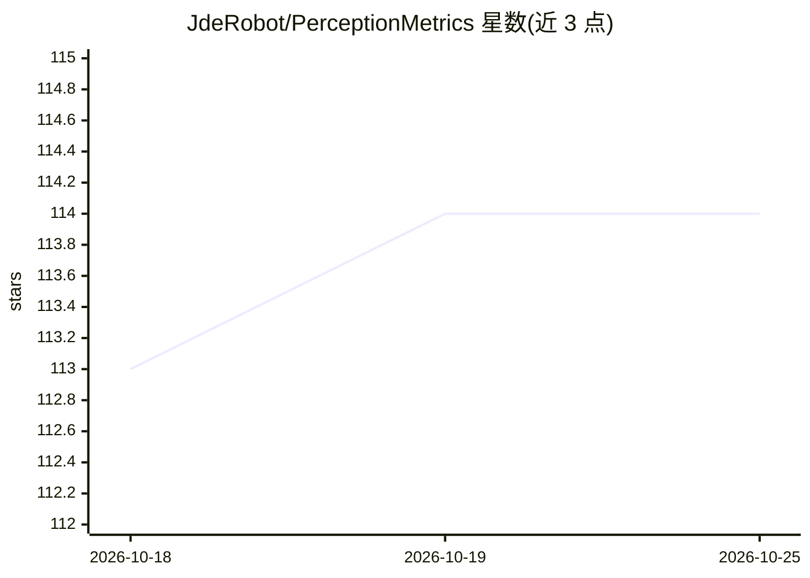

# JdeRobot/PerceptionMetrics

⭐ 114 · Python · GPL-3.0 · 推送 2026-10-15 · [GitHub](https://github.com/JdeRobot/PerceptionMetrics) · [官网](https://jderobot.github.io/PerceptionMetrics/) · 组织维护

**面向感知模型的统一评测工具箱：跨模态跨框架评测检测与分割**

为对象检测与图像/ LiDAR 分割模型提供统一评测的工具箱：对模型、数据集和度量提供一致抽象，支持跨 PyTorch/Tensorflow 框架、跨 RELLIS-3D/GOOSE/COCO/YOLO 等数据集的可复现比较。提供三种使用方式：Streamlit 交互式 GUI（仅检测任务）、Python 库与 CLI（pm_eval_model、pm_batch）。曾用名 DetectionMetrics，有 Sensors 论文；部分 LiDAR 分割模型（SphereFormer、LSK3DNet）需额外安装流程。

## 筛选速览

| 维度 | 判定 | 备注 |
|---|---|---|
| AI 角色 | `ai-ecosystem` | LLM/agent 周边工具 |
| 许可风险 | `viral` | GPL-3.0 |
| 部署形态 | `library` | 以包/库形式分发 |
| 模型依赖 | — | README 未给出锁定关系 |
| 硬件要求 | — | 无带数字的原话,不猜 |
| 安装摩擦 | `medium` | 含编译或系统依赖之一 |
| 成熟度 | — | 结构信号不足 |

## 能力要点

- 覆盖图像与 LiDAR 分割、图像对象检测三类任务
- 支持 PyTorch/Tensorflow 框架与多种数据集格式的统一抽象
- GUI（Streamlit）+ Python 库 + CLI 三种接口
- LiDAR 分割兼容 Open3D-ML、mmdetection3d、SphereFormer、LSK3DNet 模型

## 适用场景

- 批量评测检测/分割模型并导出结果 CSV
- 跨框架对比不同感知模型的指标表现
- 浏览数据集并对图像做实时推理（GUI）

## 场景标签

`模型评测` `目标检测` · 领域:评测与运维

## 证据(README 行号)

> L8: *PerceptionMetrics* is a toolkit designed to unify and streamline the evaluation of object detection and segmentatio
> L131: PerceptionMetrics can be used in three ways: through the **interactive GUI** (detection only), as a **Python libra
> L159: PerceptionMetrics provides a CLI with several commands (e.g. `pm_eval_model` and `pm_batch`). Thanks to the config

## 星数曲线

2026-10-18 113 → 2026-10-25 114（+1）

---
*卡片 v1 · prompt 1.4 · 生成 2026-10-23 · 置信度 high · 依据 README sha `41132e34100c` · [字段定义](../../DATASET.md)*
