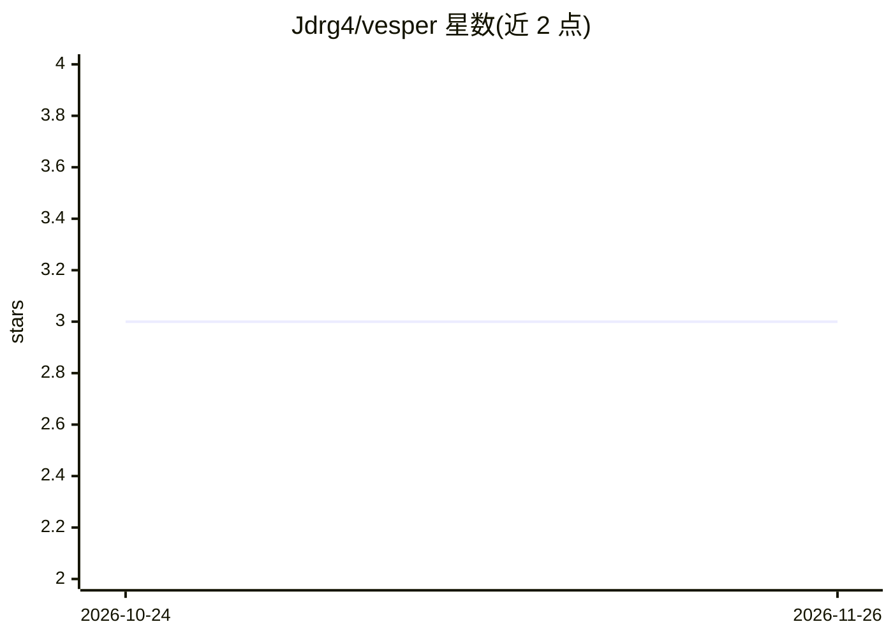

# Jdrg4/vesper

⭐ 3 · Python · NOASSERTION · 推送 2026-10-17 · [GitHub](https://github.com/Jdrg4/vesper) · 个人维护

**自托管的 GitHub 仓库 AI 代码审查 agent，自动开 PR**

Vesper 通过 GitHub App 接管指定仓库，按 cron、push webhook、手动或自由提示四种触发方式运行审查任务：克隆代码，按安全、代码质量、依赖、性能或文档维度生成修改，并以 pull request 形式提交。模型侧采用 BYOK 模式，支持 models.dev 目录中的 174 个 provider，API key 加密存储。推送前有护栏检查：diff 密钥扫描、敏感路径人工审核、最小权限 token；默认 agent 在服务器上直接执行命令，可选 AGENT_ENGINE=docker 隔离。UI 当前为西班牙语。

## 筛选速览

| 维度 | 判定 | 备注 |
|---|---|---|
| AI 角色 | `ai-native` | 本体是模型或模型工具 |
| 许可风险 | `none` | NOASSERTION |
| 部署形态 | `self-host` | docker 或自建部署 |
| 模型依赖 | — | README 未给出锁定关系 |
| 硬件要求 | — | 无带数字的原话,不猜 |
| 安装摩擦 | `low` | 无编译、无系统依赖或容器化 |
| 成熟度 | — | 结构信号不足 |

## 能力要点

- 174 个模型 provider，自带 API key 加密存储
- 四种触发方式：cron、push webhook、手动、自由提示
- PR 前护栏：密钥扫描、敏感路径拦截、最小权限安装 token
- 单 docker compose 部署，多租户与配额隔离

## 适用场景

- 夜间自动审查自己的 GitHub 仓库并生成可合并的 PR
- 团队按工作区配置模型与审查维度，跟踪依赖与安全更新
- 自托管环境下用自有模型 key 替代按席位付费的代码审查服务

## 场景标签

`代码审查` · 领域:编码与开发

## 证据(README 行号)

> L12: **Vesper is an AI agent that watches your GitHub repositories and opens pull requests.**
> L17: You bring the model. Vesper works with **174 providers** from the
> L22: > [!WARNING]

## 星数曲线

2026-10-24 3 → 2026-11-26 3（+0）

---
*卡片 v1 · prompt 1.4 · 生成 2026-11-22 · 置信度 mid · 依据 README sha `04a7f07bebe5` · [字段定义](../../DATASET.md)*
