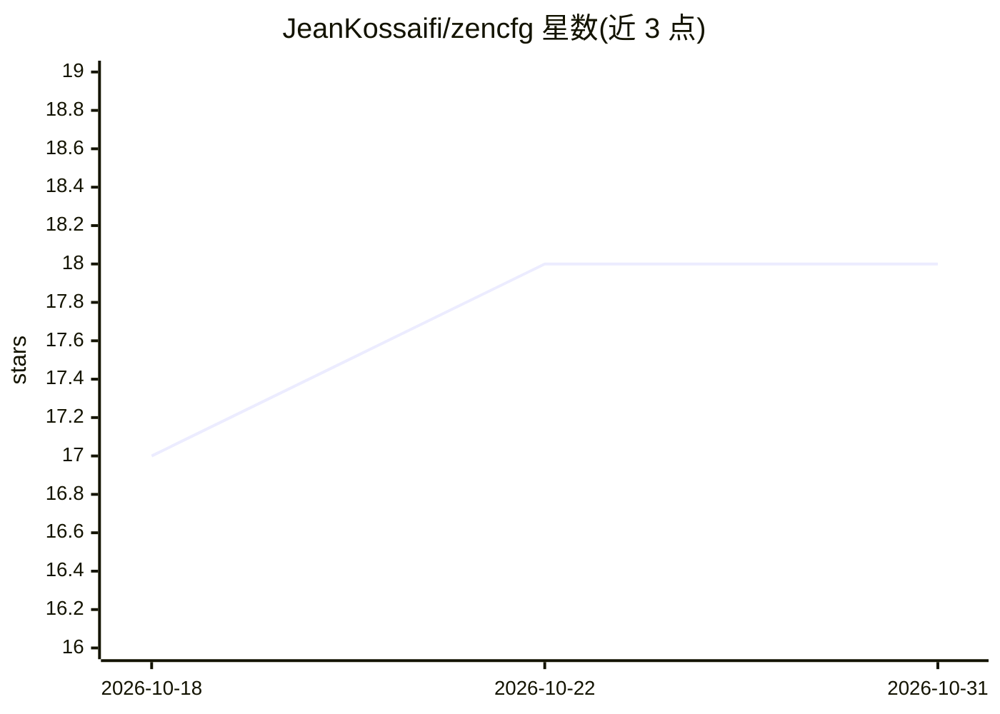

# JeanKossaifi/zencfg

⭐ 18 · Python · MIT · 推送 2026-08-26 · [GitHub](https://github.com/JeanKossaifi/zencfg) · [官网](http://jeankossaifi.com/zencfg/) · 个人维护

**面向深度学习实验的 Python 配置管理库**

基于纯 Python 类与类型提示的配置管理库：通过继承 ConfigBase 定义核心配置类别与子类别，支持嵌套组合配置对象；make_config_from_cli 可在命令行以点号语法覆盖任意嵌套参数并切换配置类型（如模型、优化器），运行时经类型提示校验，启动即报错。验证底层由 pydantic 驱动，无需专用语法。作者最初为管理深度学习实验脚本而写，可用于任意 Python 项目。以 pip 包或 git clone 源码方式安装，作者自述项目仍在开发中。

## 筛选速览

| 维度 | 判定 | 备注 |
|---|---|---|
| AI 角色 | `ai-enhanced` | 去掉 AI 部分产品仍成立 |
| 许可风险 | `permissive` | MIT |
| 部署形态 | `library` | 以包/库形式分发 |
| 模型依赖 | — | README 未给出锁定关系 |
| 硬件要求 | — | 无带数字的原话,不猜 |
| 安装摩擦 | `low` | 无编译、无系统依赖或容器化 |
| 成熟度 | `idea` | |

## 能力要点

- 纯 Python 类 + 类型提示定义配置，支持继承与嵌套组合
- make_config_from_cli 用点号语法在命令行覆盖嵌套参数并切换配置类型
- 启动时类型校验，配置错误立即抛 TypeError/ValueError
- to_dict 导出配置为字典，load_config_from_file 从文件加载

## 适用场景

- 在训练脚本中切换模型/优化器架构并覆盖其专有参数
- 避免长训练任务因配置拼写或类型错误中途失败
- 以 IDE 自动补全和类型检查维护实验配置代码

## 场景标签

 · 领域:软件工程/配置管理

## 证据(README 行号)

> L71: It was built originally to configure and manage scripts for Deep Learning experiments, but you can use it for any P

## 星数曲线

2026-10-18 17 → 2026-10-31 18（+1）

---
*卡片 v1 · prompt 1.4 · 生成 2026-10-29 · 置信度 mid · 依据 README sha `66ab6ba0a500` · [字段定义](../../DATASET.md)*
