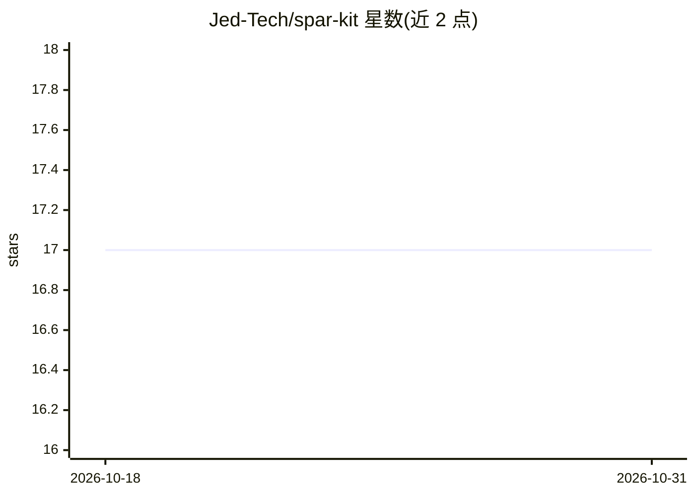

# Jed-Tech/spar-kit

⭐ 17 · JavaScript · Apache-2.0 · 推送 2026-05-07 · [GitHub](https://github.com/Jed-Tech/spar-kit) · [官网](https://jed-tech.github.io/spar-kit/) · 个人维护

**面向 AI 编程代理的仓库级工作流层：Specify→Plan→Act→Retain**

SPAR-kit 是一个安装到仓库内部的轻量工作流层，为 AI 编程代理提供四阶段循环：Specify（澄清目标与约束）、Plan（生成显式执行计划）、Act（按计划实现并校验）、Retain（将决策沉淀为项目记忆）。安装后会写入技能、低上下文代理规则、本地工具索引（.spar-kit/.local/tools.yaml）与 specs/ 目录结构，通过 spar-init 等 5 个技能驱动流程；不覆盖仓库已有 skills、rules 或 AGENTS.md。支持 Cursor、Claude Code、Codex、Copilot、Windsurf、Gemini、OpenCode 等多种代理平台，经 npx 安装器按平台选择布局。

## 筛选速览

| 维度 | 判定 | 备注 |
|---|---|---|
| AI 角色 | `ai-ecosystem` | LLM/agent 周边工具 |
| 许可风险 | `permissive` | Apache-2.0 |
| 部署形态 | `library` | 以包/库形式分发 |
| 模型依赖 | locked-api |  |
| 硬件要求 | — | 无带数字的原话,不猜 |
| 安装摩擦 | `low` | 无编译、无系统依赖或容器化 |
| 成熟度 | — | 结构信号不足 |

## 能力要点

- Specify→Plan→Act→Retain 四阶段循环，含 specs/active 与 specs/completed 归档结构
- spar-init 生成仓库工具索引 .spar-kit/.local/tools.yaml，减少代理探测环境的 token 消耗
- 通过 npx 安装器支持 Cursor/Claude Code/Codex/Copilot/Windsurf/Gemini/OpenCode 等平台布局
- 以技能+规则+模板的仓库本地层形式提供，不依赖重框架，不覆盖既有配置

## 适用场景

- 让 Cursor/Claude Code 等编程代理按规格→计划→执行的流程改代码，减少偏移
- 把已交付变更的决策保留为项目记忆，避免每次会话重建上下文
- 为代理生成仓库工具索引，明确可用的 CLI 与项目命令

## 场景标签

`编码 Agent` `工作流自动化` `Agent 记忆` · 领域:Agent 开发

## 证据(README 行号)

> L3: SPAR-kit is a lightweight, spec-driven workflow for AI-assisted software development.
> L66: SPAR-kit installs a small, repo-native workflow layer:
> L75: Reusable SPAR skills guide agents through Specify, Plan, Act, and Retain without needing

## 星数曲线

2026-10-18 17 → 2026-10-31 17（+0）

---
*卡片 v1 · prompt 1.4 · 生成 2026-10-30 · 置信度 high · 依据 README sha `722fb09ae34a` · [字段定义](../../DATASET.md)*
