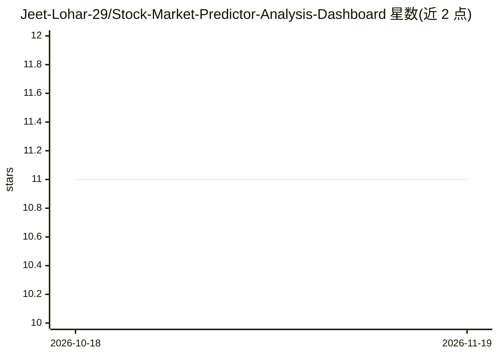

# Jeet-Lohar-29/Stock-Market-Predictor-Analysis-Dashboard

⭐ 11 · Python · 推送 2026-02-26 · [GitHub](https://github.com/Jeet-Lohar-29/Stock-Market-Predictor-Analysis-Dashboard) · 个人维护

**面向股票分析的 ML/LSTM 预测与 Power BI 仪表板项目**

整合 Power BI 仪表板与 Python 机器学习、LSTM 深度学习模型的股票市场分析项目：读取历史股票 CSV/Excel 数据，构建线性/多项式/多元回归与 MLP 回归模型及 LSTM 时序预测模型，输出 7/14/30 天多周期价格预测，并在 5 页交互式仪表板中呈现趋势、波动率、市场对比与模型性能（RMSE、R²、方向准确率）。通过 git clone 仓库后以 pip 安装依赖，运行 Jupyter notebook 训练模型，仪表板在 Power BI Desktop 中打开 .pbix 文件使用。

## 筛选速览

| 维度 | 判定 | 备注 |
|---|---|---|
| AI 角色 | `ai-native` | 本体是模型或模型工具 |
| 许可风险 | `none` | — |
| 部署形态 | `library` | 以包/库形式分发 |
| 模型依赖 | — | README 未给出锁定关系 |
| 硬件要求 | — | 无带数字的原话,不猜 |
| 安装摩擦 | `low` | 无编译、无系统依赖或容器化 |
| 成熟度 | — | 结构信号不足 |

## 能力要点

- LSTM 多周期（7D/14D/30D）股价预测
- 线性/多项式/多元回归与 MLP 模型性能对比（RMSE、R²）
- 5 页 Power BI 交互式分析仪表板（DAX、切片器、风险仪表与热力图）
- 波动率聚类检测与市场形态分类

## 适用场景

- 分析历史股票价格趋势、成交量与波动率
- 多公司横向对比与涨跌幅排行查看
- 用 LSTM 模型生成多周期价格预测并对比模型表现

## 场景标签

`金融量化` `数据分析` · 领域:效率与自动化

## 证据(README 行号)

> L14: **Stock Market Predictor & Analysis Dashboard** is a full-scale financial analytics project that integrates:
> L21: The system analyzes historical stock data, extracts market intelligence, evaluates predictive models, and generates
> L87: * LSTM-based stock price forecasting

## 星数曲线

2026-10-18 11 → 2026-11-19 11（+0）

---
*卡片 v1 · prompt 1.4 · 生成 2026-11-19 · 置信度 high · 依据 README sha `55c6eda30e00` · [字段定义](../../DATASET.md)*
