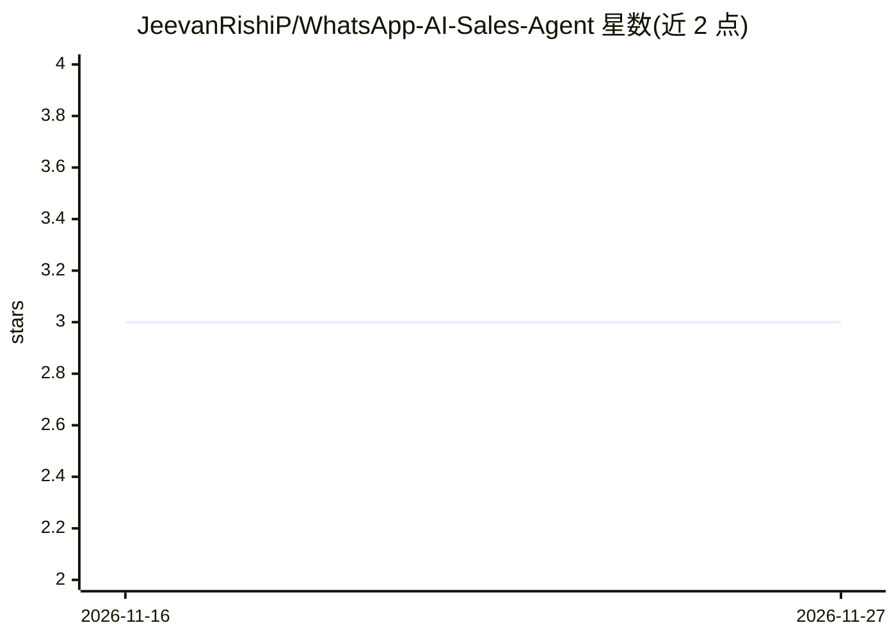

# JeevanRishiP/WhatsApp-AI-Sales-Agent

⭐ 3 · TypeScript · Apache-2.0 · 推送 2026-11-21 · [GitHub](https://github.com/JeevanRishiP/WhatsApp-AI-Sales-Agent) · 个人维护

**D2C 品牌的 WhatsApp 自主 AI 销售代理与对话式商务系统**

面向 D2C 品牌与社交卖家的 WhatsApp 商务系统：将 WhatsApp 业务通道转为全天候销售代理，理解客户意图、回答目录问题、推荐商品、管理购物车、采集收货地址、通过 Razorpay 与 PhonePe 发出即时支付链接，并实时更新商家库存。采用 pnpm/Turborepo 单体仓库，包含 Fastify API、BullMQ 队列与 Prisma 数据库层；销售代理支持 Ollama、Groq 与 OpenAI，具备上下文记忆、意图分类与结构化工具调用，Redis 会话锁防止重复消息生成。

## 筛选速览

| 维度 | 判定 | 备注 |
|---|---|---|
| AI 角色 | `ai-native` | 本体是模型或模型工具 |
| 许可风险 | `permissive` | Apache-2.0 |
| 部署形态 | `self-host` | docker 或自建部署 |
| 模型依赖 | local-ok | 支持本地模型 |
| 硬件要求 | — | 无带数字的原话,不猜 |
| 安装摩擦 | `low` | 无编译、无系统依赖或容器化 |
| 成熟度 | — | 结构信号不足 |

## 能力要点

- 内置 Ollama、Groq 与 OpenAI 接入的 LLM 销售代理（记忆、意图分类、工具调用）
- Razorpay 与 PhonePe 支付网关集成，含 HMAC-SHA256 webhook 签名校验
- Next.js 15 多租户商家仪表盘：订单、对话、库存与实时销售分析
- Redis 分布式会话锁保证并发消息下的幂等

## 适用场景

- D2C 品牌在 WhatsApp 上自动完成售前咨询与下单转化
- 社交卖家通过对话式推荐与购物车管理卖货
- 多商家场景下统一管理订单、库存与销售数据

## 场景标签

`聊天机器人` · 领域:对话与助手

## 证据(README 行号)

> L3: > **Autonomous AI-powered WhatsApp Sales Agent & Conversational Commerce Engine for D2C Brands and Social Sellers.**
> L29: * **🧠 Autonomous LLM Sales Agent**: Built-in support for Ollama, Groq, and OpenAI with contextual memory, intent cl

## 星数曲线

2026-11-16 3 → 2026-11-27 3（+0）

---
*卡片 v1 · prompt 1.4 · 生成 2026-11-22 · 置信度 high · 依据 README sha `32f257fb43ce` · [字段定义](../../DATASET.md)*
