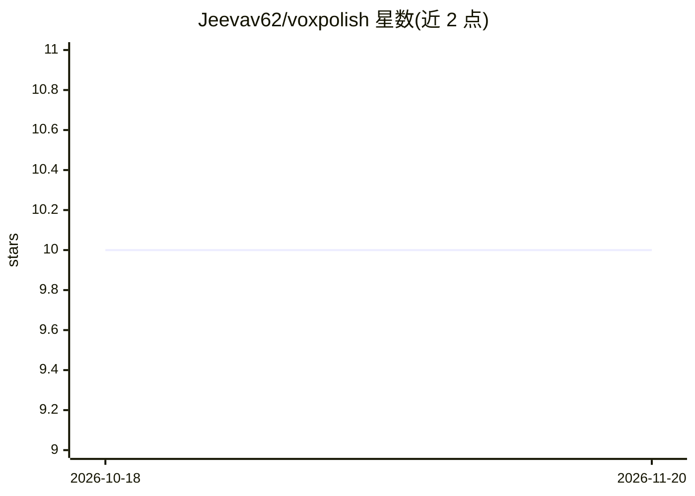

# Jeevav62/voxpolish

⭐ 10 · Python · MIT · 推送 2026-06-22 · [GitHub](https://github.com/Jeevav62/voxpolish) · 个人维护

**TTS 训练数据集一键清洗工具：降噪、剪静音、响度归一**

面向文本转语音（TTS）训练数据清洗的命令行与 Web 工具：将数据集经三阶段流水线处理——基于神经网络的去噪（DeepFilterNet）、首尾静音剪切、响度归一化到 -23 LUFS（EBU R128）。自动识别 LJSpeech/VCTK/普通文件夹三种数据布局，保留 metadata.csv、目录结构与原始采样率。支持 GPU 或 CPU 运行，附 Gradio Web UI 与逐文件处理报告。面向需要批量准备语音训练数据的开发者。

## 筛选速览

| 维度 | 判定 | 备注 |
|---|---|---|
| AI 角色 | `ai-native` | 本体是模型或模型工具 |
| 许可风险 | `permissive` | MIT |
| 部署形态 | `self-host` | docker 或自建部署 |
| 模型依赖 | — | README 未给出锁定关系 |
| 硬件要求 | `cpu-ok` | |
| 安装摩擦 | `low` | 无编译、无系统依赖或容器化 |
| 成熟度 | — | 结构信号不足 |

## 能力要点

- 三阶段流水线：神经去噪、静音剪切、响度归一化（-23 LUFS）
- 自动识别 LJSpeech/VCTK/原始文件夹数据集格式并保留结构与采样率
- GPU/CPU 均可运行，附 Docker、一键脚本与 Gradio Web UI 三种使用路径
- 逐文件处理报告，各阶段可通过命令行参数开关与调节

## 适用场景

- 批量清洗带背景噪声的语音录音用于 TTS 训练
- 统一 LJSpeech/VCTK 数据集的响度与首尾静音
- 无 GPU 环境下用 CPU 慢速清洗数据集
- 通过浏览器上传 ZIP 在线体验清洗效果

## 场景标签

 · 领域:语音/机器学习数据处理

## 证据(README 行号)

> L23: **VoxPolish is an open-source TTS dataset cleaner.** Training a good text-to-speech (TTS) model needs **clean audio
> L29: |🔇 **Noise Removal**|Neural deep-learning denoiser|Clean speech = clean voice clones|
> L61: - 🖥️ **GPU or CPU** — runs anywhere; uses your GPU automatically if available

## 星数曲线

2026-10-18 10 → 2026-11-20 10（+0）

---
*卡片 v1 · prompt 1.4 · 生成 2026-11-20 · 置信度 high · 依据 README sha `5881ca0c95f4` · [字段定义](../../DATASET.md)*
