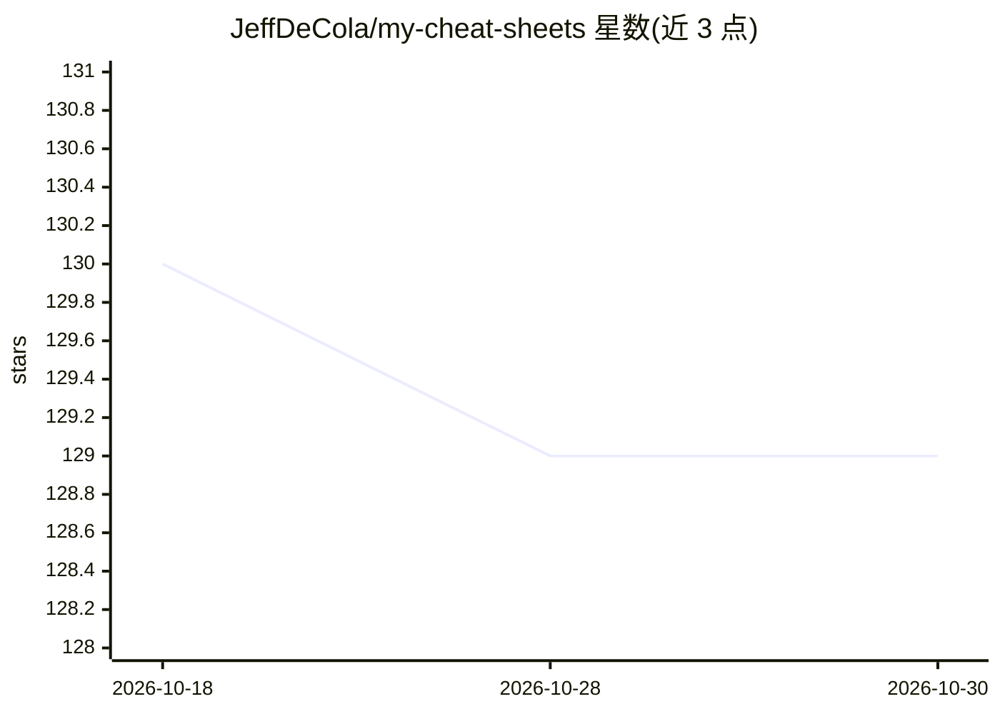

# JeffDeCola/my-cheat-sheets

⭐ 129 · Go · MIT · 推送 2026-06-08 · [GitHub](https://github.com/JeffDeCola/my-cheat-sheets) · 个人维护

**个人开发知识速查表合集：覆盖软件开发、ASIC/FPGA 与通识主题**

个人维护的 cheat sheet 文档仓库，按三大部分组织：软件（开发环境、语言、操作系统、架构、CI/CD、编排、遥测、云服务商）、硬件（FPGA 开发板、Verilog、仿真/综合工具）与其他主题（美国历史、影视制作、STEM、数学）。其中 AI 部分为条目索引，涵盖 AI 概述、神经网络、ai stack 配置、openclaw agent、ollama 推理层与 LLM 训练等。内容为作者从外部资料收集整理的笔记，配 GitHub Pages 网页，经 Concourse 构建。MIT 许可。

## 筛选速览

| 维度 | 判定 | 备注 |
|---|---|---|
| AI 角色 | `ai-knowledge` | 知识聚合/清单类 |
| 许可风险 | `permissive` | MIT |
| 部署形态 | `None` |  |
| 模型依赖 | — | README 未给出锁定关系 |
| 硬件要求 | — | 无带数字的原话,不猜 |
| 安装摩擦 | `low` | 无编译、无系统依赖或容器化 |
| 成熟度 | — | 结构信号不足 |

## 能力要点

- 软件/硬件/通识三大类目录式组织，含数百个主题条目
- AI 章节覆盖基础、推理层（ollama）、LLM 层与 agent 配置
- 提供 GitHub Pages 文档站，由 Concourse 持续构建

## 适用场景

- 开发过程中快速查阅命令、工具与概念速查表
- 了解 ASIC/FPGA 与软件开发全流程的工具图谱
- 查找 LLM/agent 相关主题的学习笔记索引

## 场景标签

`精选清单` · 领域:学习与行业

## 证据(README 行号)

> L7: _A place to keep all my cheat sheets
> L153:  * ARTIFICIAL INTELLIGENCE
> L161:  * ai stack configurations - from chatbots to agents

## 星数曲线

2026-10-18 130 → 2026-10-30 129（-1）

---
*卡片 v1 · prompt 1.4 · 生成 2026-10-22 · 置信度 high · 依据 README sha `ce40d75ded70` · [字段定义](../../DATASET.md)*
