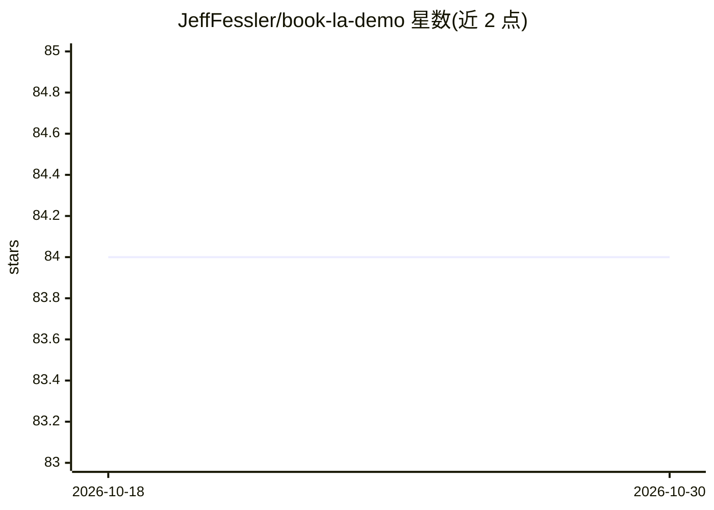

# JeffFessler/book-la-demo

⭐ 84 · HTML · NOASSERTION · 推送 2026-10-29 · [GitHub](https://github.com/JeffFessler/book-la-demo) · [官网](https://jefffessler.github.io/book-la-demo/) · 组织维护

**《线性代数》教材配套 Julia 演示代码库**

Jeff Fessler 与 Raj Nadakuditi（密歇根大学）所著《Linear Algebra for Data Science, Machine Learning, and Signal Processing》（剑桥大学出版社 2024）一书的配套演示代码仓库，以 Julia 语言（要求 1.9 及以上）编写。内容按章节组织成 notebook 形式的演示索引，涵盖 SVD、最小二乘、PCA、谱聚类、矩阵补全、非负矩阵分解、MLP 神经网络等约 40 个示例，并提供在线浏览按钮与勘误表链接。面向教材读者与自学数据科学/信号处理的学生使用。

## 筛选速览

| 维度 | 判定 | 备注 |
|---|---|---|
| AI 角色 | `ai-knowledge` | 知识聚合/清单类 |
| 许可风险 | `none` | NOASSERTION |
| 部署形态 | `None` |  |
| 模型依赖 | — | README 未给出锁定关系 |
| 硬件要求 | — | 无带数字的原话,不猜 |
| 安装摩擦 | `low` | 无编译、无系统依赖或容器化 |
| 成熟度 | — | 结构信号不足 |

## 能力要点

- Julia 语言编写，要求 Julia 1.9+
- 按教材章节组织约 40 个演示 notebook
- 覆盖 SVD、PCA、谱聚类、NMF、MLP 等主题
- 提供 Binder 在线浏览与勘误表入口

## 适用场景

- 配合教材逐步运行章节演示代码
- 学习线性代数在数据科学与信号处理中的应用
- 在线浏览演示而无需本地安装

## 场景标签

`教程课程` · 领域:学习与行业

## 证据(README 行号)

> L8: This repo contains demo code
> L13: Data Science, Machine Learning, and Signal Processing"
> L53: # Demo index

## 星数曲线

2026-10-18 84 → 2026-10-30 84（+0）

---
*卡片 v1 · prompt 1.4 · 生成 2026-10-24 · 置信度 high · 依据 README sha `a1d894c790c2` · [字段定义](../../DATASET.md)*
