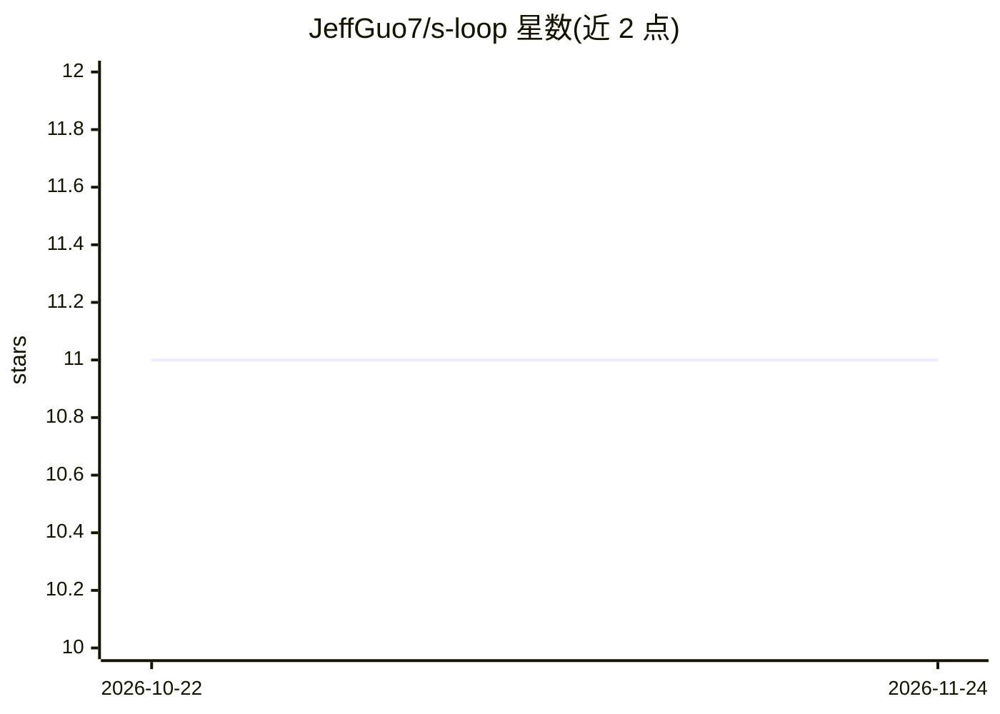

# JeffGuo7/s-loop

⭐ 11 · TypeScript · MIT · 推送 2026-10-26 · [GitHub](https://github.com/JeffGuo7/s-loop) · 个人维护 · 中文 README

**Windows 本地优先 AI 桌面工作台：聊天、代理编排与定时任务**

基于 Tauri 2 的本地优先 AI 工作台，集成流式聊天、拖拽式 Agent 构建器、子代理与自主目标循环、cron 定时任务、消息平台集成、离线语音输入和桌面宠物。通过 pi SDK 内置 39 个模型供应商接入并支持自定义 OpenAI 兼容端点。安全模型包括工作区沙箱、审批队列、执行审计、DPAPI 加密凭据与 Windows AppContainer 沙箱。Windows 提供安装包，开发需 Node.js ≥20 与 Rust ≥1.85。

## 筛选速览

| 维度 | 判定 | 备注 |
|---|---|---|
| AI 角色 | `ai-native` | 本体是模型或模型工具 |
| 许可风险 | `permissive` | MIT |
| 部署形态 | `desktop` | 安装包/桌面程序 |
| 模型依赖 | locked-api |  |
| 硬件要求 | — | 无带数字的原话,不猜 |
| 安装摩擦 | `low` | 无编译、无系统依赖或容器化 |
| 成熟度 | — | 结构信号不足 |

## 能力要点

- 39 个内置模型供应商接入，支持自定义 OpenAI 兼容端点
- 拖拽式 Agent 构建器，支持子代理与自主目标循环
- MCP 客户端支持 Streamable HTTP/stdio 传输与 OAuth 2.1 登录
- 工作区沙箱 + 两级 Shell 策略 + 耐久审批与审计追踪

## 适用场景

- 在桌面端统一接入多家模型供应商进行对话与工具调用
- 用拖拽方式搭建自定义代理并定时执行任务
- 通过 Telegram/飞书/钉钉等平台接入代理消息
- 需要审批留痕与沙箱隔离的本地代理执行环境

## 场景标签

`AI 助手` `Agent 框架` `工作流自动化` · 领域:Agent 开发

## 证据(README 行号)

> L18: S-Loop is a local-first AI workbench for Windows. One app gives you streaming chat with
> L30: |**Model Providers**|39 built-in providers via the pi SDK — DeepSeek, OpenAI, Anthropic, Google, GLM (Z.ai), Moonsh
> L32: |**Sub-agents & Goal Loop**|`delegate_task` / parallel / chained sub-agents with budgets and cancellation; goal loo

## 星数曲线

2026-10-22 11 → 2026-11-24 11（+0）

---
*卡片 v1 · prompt 1.4 · 生成 2026-11-19 · 置信度 high · 依据 README sha `78c6b3f7d4b1` · [字段定义](../../DATASET.md)*
