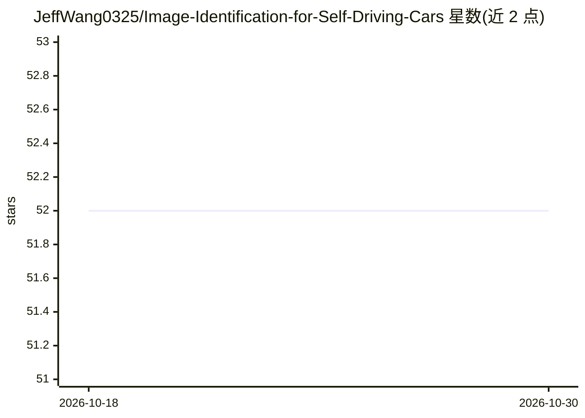

# JeffWang0325/Image-Identification-for-Self-Driving-Cars

⭐ 52 · Python · GPL-3.0 · 推送 2026-10-26 · [GitHub](https://github.com/JeffWang0325/Image-Identification-for-Self-Driving-Cars) · 个人维护 · 中文 README

**自动驾驶影像识别桌面应用：YOLOv5 检测加红绿灯/标志分类**

基于 Python/Tkinter 的图形界面应用，面向自动驾驶场景的影像识别：先用 YOLOv5 做目标检测（类别含汽车、行人、骑行者、红绿灯、交通标志等），再裁剪红绿灯与交通标志图像分别做图像分类。GUI 支持 Folder/Image/YouTube/DroidCam/WebCam 五种输入源，提供图像显示、YOLOv5 与分类模型的参数调整、信息页（含尺寸、检测结果、各模型计算耗时）。需自行下载模型与图像文件并放到指定路径后运行主程序。

## 筛选速览

| 维度 | 判定 | 备注 |
|---|---|---|
| AI 角色 | `ai-native` | 本体是模型或模型工具 |
| 许可风险 | `viral` | GPL-3.0 |
| 部署形态 | `library` | 以包/库形式分发 |
| 模型依赖 | — | README 未给出锁定关系 |
| 硬件要求 | — | 无带数字的原话,不猜 |
| 安装摩擦 | `low` | 无编译、无系统依赖或容器化 |
| 成熟度 | — | 结构信号不足 |

## 能力要点

- YOLOv5 目标检测，覆盖 8 类道路对象
- 红绿灯与交通标志裁剪后分别做图像分类
- Tkinter GUI 支持 Folder/Image/YouTube/DroidCam/WebCam 输入源
- 信息页显示图像尺寸、检测结果与各模型计算耗时

## 适用场景

- 对图片/视频/摄像头画面做道路目标检测
- 识别红绿灯与交通标志类别并查看耗时
- 用手机 DroidCam 作为 IP 摄像头实时检测

## 场景标签

`目标检测` · 领域:感知与多模态

## 证据(README 行号)

> L4: First, use **yolov5** for **object detection** whose class includes car, truck, pedestrian, bicyclist, traffic light
> L6: Second, crop the images of **traffic light** and **traffic sign** to execute the **image classification** respective

## 星数曲线

2026-10-18 52 → 2026-10-30 52（+0）

---
*卡片 v1 · prompt 1.4 · 生成 2026-10-24 · 置信度 mid · 依据 README sha `cba07106485a` · [字段定义](../../DATASET.md)*
