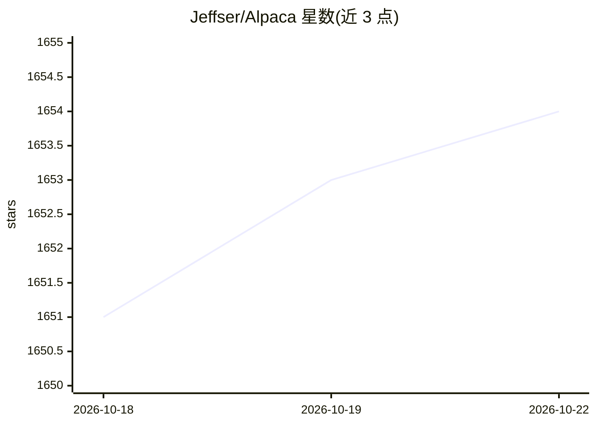

# Jeffser/Alpaca

⭐ 1,654 · Python · GPL-3.0 · 推送 2026-10-02 · [GitHub](https://github.com/Jeffser/Alpaca) · [官网](https://jeffser.com/alpaca) · 个人维护

**GNOME 桌面的 Ollama 客户端：本地/云端模型聊天界面**

面向 GNOME/GTK4 桌面的 Ollama 图形客户端：在应用内拉取、删除模型并与多个模型对话，支持图像识别、纯文本文档识别、YouTube 视频与网页内容问答、对话导入导出等；也可通过 OpenAI 兼容 API 与自有 key 使用 Gemini、ChatGPT 等云端模型。面向本地 AI 的入门用户，通过 Flathub 分发，附免责声明：项目与 Ollama 无隶属关系，不承担模型生成代码造成的损害。

## 筛选速览

| 维度 | 判定 | 备注 |
|---|---|---|
| AI 角色 | `ai-ecosystem` | LLM/agent 周边工具 |
| 许可风险 | `viral` | GPL-3.0 |
| 部署形态 | `None` |  |
| 模型依赖 | local-ok | 支持本地模型 |
| 硬件要求 | — | 无带数字的原话,不猜 |
| 安装摩擦 | `low` | 无编译、无系统依赖或容器化 |
| 成熟度 | — | 结构信号不足 |

## 能力要点

- 应用内拉取/删除 Ollama 模型并多模型对话
- 图像识别、文本文档识别、YouTube/网页内容问答
- 通过 OpenAI 兼容 API 与自有 key 使用 Gemini、ChatGPT 等云端模型
- 多会话管理、消息编辑/重生成、聊天导入导出

## 适用场景

- 在 Linux 桌面上以图形界面管理并对话本地 Ollama 模型
- 用自有 API key 在同一应用中访问云端模型
- 对图片、文本文档、YouTube 视频和网页提问

## 场景标签

`聊天机器人` `文档问答` `多模态` · 领域:对话与助手

## 证据(README 行号)

> L3:  Alpaca is an Ollama client where you can manage and chat with multiple models, Alpaca provides an easy and beginner
> L32: - Talk to cloud-hosted models with OpenAI-compatible APIs using your own API keys

## 星数曲线

2026-10-18 1,651 → 2026-10-22 1,654（+3）

---
*卡片 v1 · prompt 1.4 · 生成 2026-10-21 · 置信度 high · 依据 README sha `c4b09c4a2dbb` · [字段定义](../../DATASET.md)*
