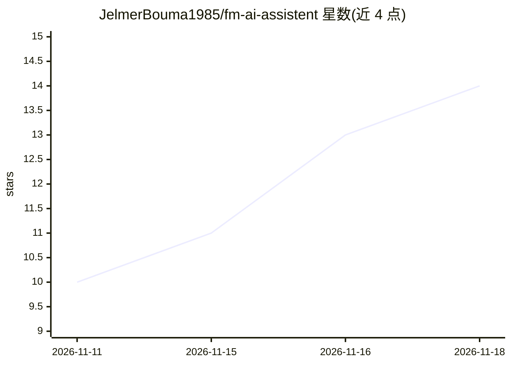

# JelmerBouma1985/fm-ai-assistent

⭐ 14 · Java · 推送 2026-11-17 · [GitHub](https://github.com/JelmerBouma1985/fm-ai-assistent) · [官网](https://fmaiassistant.com) · 个人维护

**读取 FM27 存档并提供 AI 球探/战术建议的本地桌面应用**

面向 Football Manager 2027 的本地伴随应用，从内存直接读取已加载的存档，提供球员、员工、俱乐部与赛事的检索比较、属性/合同/预算查看，以及 .fmf 战术文件解析。AI 部分通过内嵌聊天接入本地已安装的 Codex、Antigravity、GitHub Copilot 或带 API key 的 OpenRouter，提供引援、阵容与战术建议，并暴露 fm27_* 系列工具供 agent 调用，可生成可导入的球员短名单 .fmf 文件。数据本地处理，聊天内容与上下文发送至所选 provider；API key 仅存于会话内存。

## 筛选速览

| 维度 | 判定 | 备注 |
|---|---|---|
| AI 角色 | `ai-enhanced` | 去掉 AI 部分产品仍成立 |
| 许可风险 | `none` | — |
| 部署形态 | `None` |  |
| 模型依赖 | locked-api |  |
| 硬件要求 | — | 无带数字的原话,不猜 |
| 安装摩擦 | `medium` | 含编译或系统依赖之一 |
| 成熟度 | — | 结构信号不足 |

## 能力要点

- 从内存直接读取 FM27 存档，快照原子提交
- 内嵌聊天接入 Codex/Antigravity/GitHub Copilot 与 OpenRouter
- fm27_* 系列工具：阵容优化、战术槽引援、短名单 .fmf 生成
- MCP 端点供本地 agent 注册（codex mcp add）

## 适用场景

- 在 FM27 中让 AI 帮我找符合战术槽的引援目标
- 上传 .fmf 战术后生成最佳 XI 与深度诊断
- 用工具调用生成可直接导入游戏的球员短名单
- 检索比较球员与员工的属性、合同与教练角色评分

## 场景标签

 · 领域:游戏辅助/数据分析

## 证据(README 行号)

> L9: FM AI Assistent is a local companion app for **Football Manager 2027** on Windows 11 and Linux.
> L17: - ask an AI assistant for recruitment, squad and tactical advice;
> L84: The embedded chat supports locally installed **Codex**, **Antigravity** and **GitHub Copilot**, plus **OpenRouter**

## 星数曲线

2026-11-11 10 → 2026-11-18 14（+4）

---
*卡片 v1 · prompt 1.4 · 生成 2026-11-18 · 置信度 high · 依据 README sha `8f5e3ff86116` · [字段定义](../../DATASET.md)*
