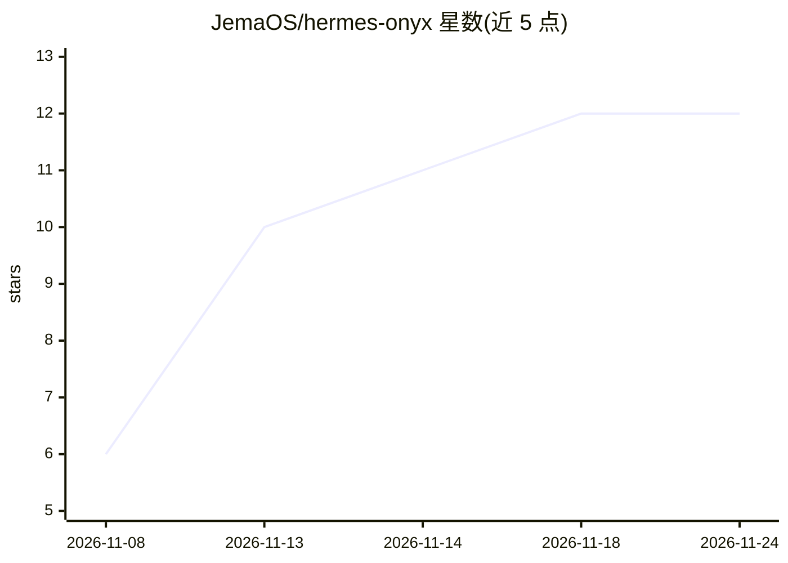

# JemaOS/hermes-onyx

⭐ 12 · Kotlin · NOASSERTION · 推送 2026-11-16 · [GitHub](https://github.com/JemaOS/hermes-onyx) · [官网](https://jemaos.github.io/hermes-onyx/) · 组织维护 · 中文 README

**自托管 Hermes agent 的 Android 客户端：流式聊天、机器人房间与语音**

面向自行运行 Hermes Dashboard 用户的 Android 客户端，用 Kotlin/Jetpack Compose 编写。连接到用户自托管的 Hermes agent 网关，提供流式对话（SSE）、多机器人与房间互答、免提语音对话、远程桌面查看与触控、代码会话管理、文件/看板/终端/日志等服务器面板访问，以及 Wear OS 与 Android Auto 伴侣端。应用本身不内置模型或密钥，所有模型配置与用量数据从服务器读取；通过 F-Droid 仓库分发，1.0.0+980 之后签名证书更换，升级需先卸载旧版。

## 筛选速览

| 维度 | 判定 | 备注 |
|---|---|---|
| AI 角色 | `ai-ecosystem` | LLM/agent 周边工具 |
| 许可风险 | `none` | NOASSERTION |
| 部署形态 | `None` |  |
| 模型依赖 | — | README 未给出锁定关系 |
| 硬件要求 | — | 无带数字的原话,不猜 |
| 安装摩擦 | `medium` | 含编译或系统依赖之一 |
| 成熟度 | — | 结构信号不足 |

## 能力要点

- 流式对话（SSE）含推理折叠、工具调用、审批卡与恢复点
- 多机器人房间互答与逐个语音轮替，免提语音支持打断
- 远程查看并触控自己的机器，带审批门与自适应画质
- 机器人可配置 skills、toolsets 与 MCP servers

## 适用场景

- 在手机上与自托管 Hermes agent 流式对话并管理文件交付
- 用语音免提与多个专家机器人轮流对话
- 远程查看和操控自己电脑上的 agent 运行环境
- 在 Wear OS 或 Android Auto 上访问自己的 agent

## 场景标签

`语音 Agent` `AI 助手` · 领域:对话与助手

## 证据(README 行号)

> L3: **The Android client for the Hermes agent you run yourself.**
> L20: APK, and no telemetry. You point it at the Hermes Dashboard you already run, and it becomes the remote

## 星数曲线

2026-11-08 6 → 2026-11-24 12（+6）

---
*卡片 v1 · prompt 1.4 · 生成 2026-11-18 · 置信度 high · 依据 README sha `ffab1ea0ce71` · [字段定义](../../DATASET.md)*
