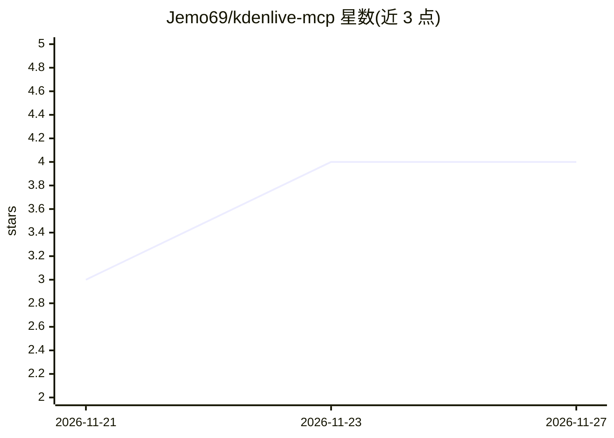

# Jemo69/kdenlive-mcp

⭐ 4 · Python · MIT · 推送 2026-10-22 · [GitHub](https://github.com/Jemo69/kdenlive-mcp) · 个人维护

**让 MCP 客户端直接读写 Kdenlive 工程文件的 MCP 服务器**

一个纯 Python 的 MCP 服务器，绕过 Kdenlive GUI，直接读写其 MLT XML 工程文件，因此在 Linux、macOS、Windows、WSL 及 CI 中可无头运行。提供约 30 个工具，覆盖工程检查、时间线剪辑增删移动分割、效果与转场、撤销/检查点、媒体探测与后台渲染。渲染依赖 MLT 的 melt 命令行（随 Kdenlive 附带），WSL 场景通过 stdlib 实现的 HTTP bridge 在 Windows 侧渲染或打开编辑器，bridge 默认无鉴权需自行传 token。

## 筛选速览

| 维度 | 判定 | 备注 |
|---|---|---|
| AI 角色 | `ai-ecosystem` | LLM/agent 周边工具 |
| 许可风险 | `permissive` | MIT |
| 部署形态 | `desktop` | 安装包/桌面程序 |
| 模型依赖 | — | README 未给出锁定关系 |
| 硬件要求 | — | 无带数字的原话,不猜 |
| 安装摩擦 | `low` | 无编译、无系统依赖或容器化 |
| 成熟度 | — | 结构信号不足 |

## 能力要点

- 直接读写 MLT XML，无需 Kdenlive 运行，可在无头/CI 环境工作
- 约 30 个 MCP 工具：时间线编辑、效果转场、撤销与命名检查点
- 每次保存保留 .bak，变更记录审计历史，可撤销/重做
- WSL→Windows bridge 支持跨系统渲染和打开 Kdenlive GUI

## 适用场景

- 用 Claude Desktop 等客户端通过对话剪辑 Kdenlive 时间线
- 在 CI 或无 GUI 的服务器上批量处理视频工程文件
- WSL 中编辑 Windows 盘上的工程并跨系统渲染

## 场景标签

`图像视频处理` · 领域:感知与多模态

## 证据(README 行号)

> L6: An MCP server that drives Kdenlive — the KDE video editor.
> L110: The server speaks MCP over stdio. Configuration for the common clients:

## 星数曲线

2026-11-21 3 → 2026-11-27 4（+1）

---
*卡片 v1 · prompt 1.4 · 生成 2026-11-22 · 置信度 high · 依据 README sha `f88b3d46c7c9` · [字段定义](../../DATASET.md)*
