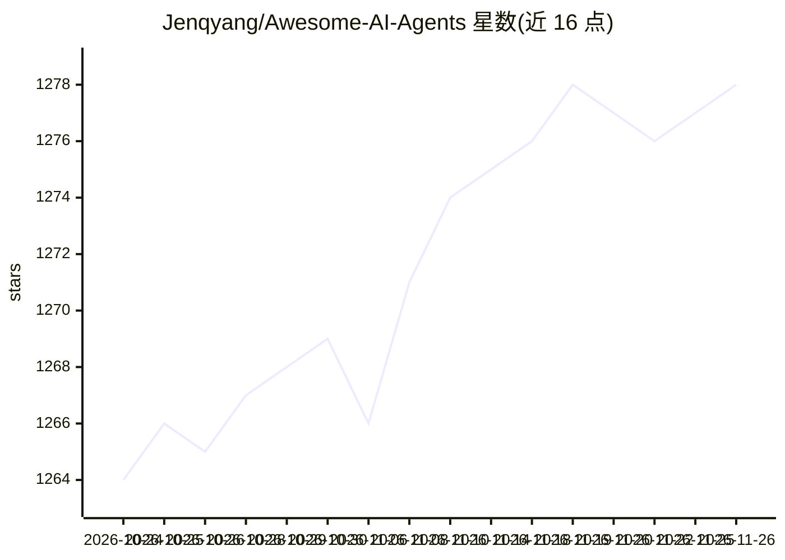

# Jenqyang/Awesome-AI-Agents

⭐ 1,278 · JavaScript · 推送 2026-11-24 · [GitHub](https://github.com/Jenqyang/Awesome-AI-Agents) · [官网](https://jenqyang.github.io/Awesome-AI-Agents/) · 个人维护

**LLM 驱动的自主智能体项目策展清单**

以清单形式收录 LLM 驱动的自主 agent 开源项目，按 Applications 等类别组织，每个条目附一句话描述与 GitHub/论文链接，并提供可检索的网站版本。条目覆盖任务求解、编码、研究、浏览器操作、视频创作、个人助理等方向，部分条目注明许可证、部署方式（Docker/self-hosted）与所支持的模型提供方。本体为目录索引，不含可安装运行的代码。

## 筛选速览

| 维度 | 判定 | 备注 |
|---|---|---|
| AI 角色 | `ai-knowledge` | 知识聚合/清单类 |
| 许可风险 | `none` | — |
| 部署形态 | `self-host` | docker 或自建部署 |
| 模型依赖 | — | README 未给出锁定关系 |
| 硬件要求 | — | 无带数字的原话,不猜 |
| 安装摩擦 | `low` | 无编译、无系统依赖或容器化 |
| 成熟度 | — | 结构信号不足 |

## 能力要点

- 收录大量 LLM 自主 agent 开源项目并附链接
- 提供可搜索的网站版本
- 部分条目注明许可证与部署方式

## 适用场景

- 寻找某一方向的自主 agent 开源项目
- 调研 LLM agent 生态的项目分布

## 场景标签

`精选清单` · 领域:学习与行业

## 证据(README 行号)

> L1: # Awesome-AI-Agents 🤖️
> L9: ## Applications
> L13: Open-source Large Language Model (LLM) driven autonomous agent that can automatically solve various tasks.

## 星数曲线

2026-10-24 1,264 → 2026-11-26 1,278（+14）

---
*卡片 v1 · prompt 1.4 · 生成 2026-11-26 · 置信度 mid · 依据 README sha `4f00637edbd7` · [字段定义](../../DATASET.md)*
