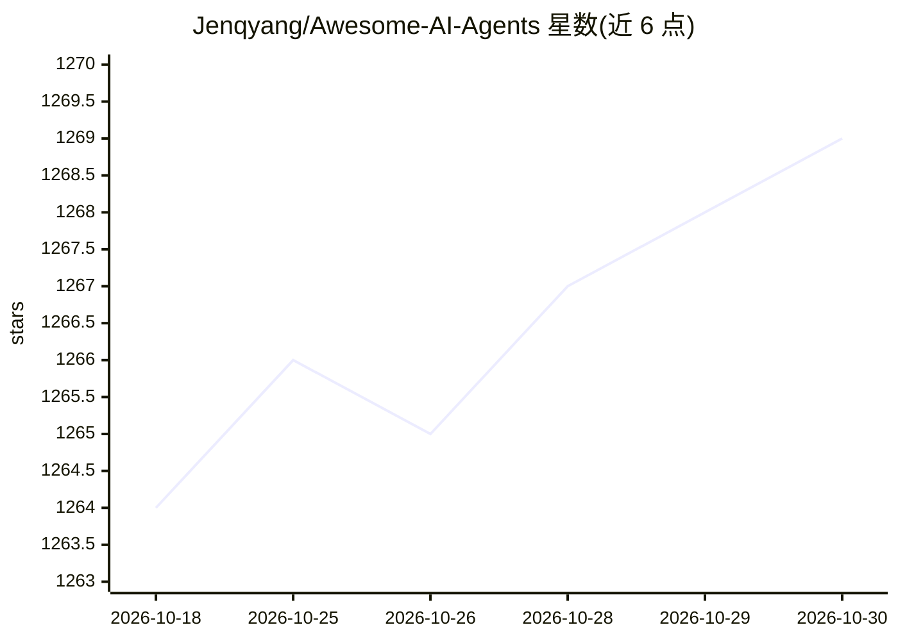

# Jenqyang/Awesome-AI-Agents

⭐ 1,269 · JavaScript · 推送 2026-10-27 · [GitHub](https://github.com/Jenqyang/Awesome-AI-Agents) · [官网](https://jenqyang.github.io/Awesome-AI-Agents/) · 个人维护 · 中文 README

**LLM 自主 Agent 项目策展清单：收录各类开源 Agent 应用**

Awesome 类策展清单，收录由 LLM 驱动的自主 Agent 项目，按应用类别组织，当前可见部分为 Autonomous Agent Task Solver Projects：覆盖自主编程 Agent（SWE-agent、Cline）、研究/写作 Agent、桌面与浏览器自动化 Agent、自托管个人助手、多 Agent 系统等条目。每条目给出名称、一句话描述与 GitHub 链接，另提供可搜索的网站入口。面向寻找 AI Agent 项目与生态概览的开发者，本体不含可安装的代码。

## 筛选速览

| 维度 | 判定 | 备注 |
|---|---|---|
| AI 角色 | `ai-knowledge` | 知识聚合/清单类 |
| 许可风险 | `none` | — |
| 部署形态 | `self-host` | docker 或自建部署 |
| 模型依赖 | — | README 未给出锁定关系 |
| 硬件要求 | — | 无带数字的原话,不猜 |
| 安装摩擦 | `low` | 无编译、无系统依赖或容器化 |
| 成熟度 | — | 结构信号不足 |

## 能力要点

- 按类别组织的 LLM 自主 Agent 项目收录清单
- 条目覆盖编程、研究写作、桌面/浏览器自动化、自托管助手等多类 Agent
- 提供可搜索的配套网站

## 适用场景

- 寻找适合自己需求的开源 AI Agent 项目
- 了解 LLM 自主 Agent 生态的项目分布

## 场景标签

`精选清单` · 领域:学习与行业

## 证据(README 行号)

> L1: # Awesome-AI-Agents 🤖️
> L9: ## Applications
> L13: Open-source Large Language Model (LLM) driven autonomous agent that can automatically solve various tasks.

## 星数曲线

2026-10-18 1,264 → 2026-10-30 1,269（+5）

---
*卡片 v1 · prompt 1.4 · 生成 2026-10-21 · 置信度 mid · 依据 README sha `a165844ae0a8` · [字段定义](../../DATASET.md)*
