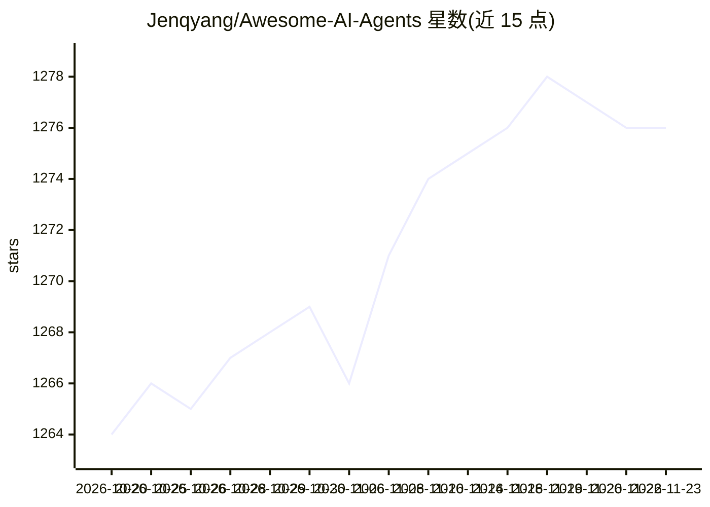

# Jenqyang/Awesome-AI-Agents

⭐ 1,276 · JavaScript · 推送 2026-11-20 · [GitHub](https://github.com/Jenqyang/Awesome-AI-Agents) · [官网](https://jenqyang.github.io/Awesome-AI-Agents/) · 个人维护

**面向关注 AI Agent 者的 LLM 自主 agent 项目清单**

收录由 LLM 驱动的自主 agent 开源项目链接清单，按 Applications 等分类组织，条目附一句话简介与 GitHub 仓库链接，覆盖任务求解、编程、研究、视频创作、个人助理等方向，并提供可检索网站入口。该仓库本身不包含代码或模型，仅提供项目编目与外部链接，供使用者浏览查找相关项目。

## 筛选速览

| 维度 | 判定 | 备注 |
|---|---|---|
| AI 角色 | `ai-knowledge` | 知识聚合/清单类 |
| 许可风险 | `none` | — |
| 部署形态 | `self-host` | docker 或自建部署 |
| 模型依赖 | — | README 未给出锁定关系 |
| 硬件要求 | — | 无带数字的原话,不猜 |
| 安装摩擦 | `low` | 无编译、无系统依赖或容器化 |
| 成熟度 | — | 结构信号不足 |

## 能力要点

- 按 Applications 等分类组织的项目编目
- 条目附 GitHub 链接与一句话简介
- 提供可检索网站入口
- 覆盖编程/研究/视频/个人助理等多类 agent 项目

## 适用场景

- 查找特定方向的自主 agent 开源项目
- 浏览 LLM agent 生态有哪些已收录项目
- 通过清单链接快速跳转到各项目仓库

## 场景标签

`精选清单` · 领域:学习与行业

## 证据(README 行号)

> L1: # Awesome-AI-Agents 🤖️
> L9: ## Applications
> L13: Open-source Large Language Model (LLM) driven autonomous agent that can automatically solve various tasks.

## 星数曲线

2026-10-20 1,264 → 2026-11-23 1,276（+12）

---
*卡片 v1 · prompt 1.4 · 生成 2026-11-23 · 置信度 mid · 依据 README sha `c8bd289841d4` · [字段定义](../../DATASET.md)*
