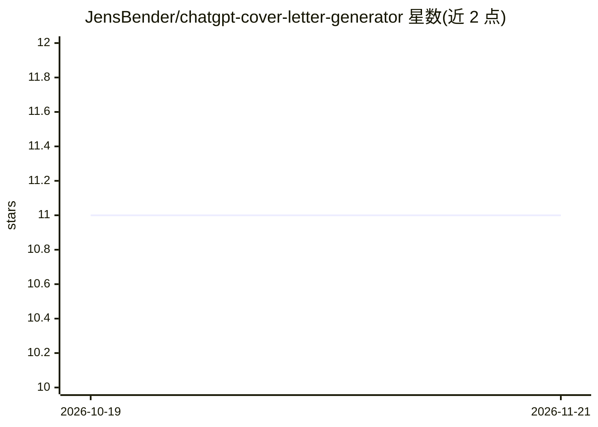

# JensBender/chatgpt-cover-letter-generator

⭐ 11 · Jupyter Notebook · MIT · 推送 2026-02-06 · [GitHub](https://github.com/JensBender/chatgpt-cover-letter-generator) · 个人维护

**求职者用 LLM 从职位链接生成定制求职信**

基于 Python 与 Jupyter Notebook 的工作流工具：抓取职位发布页文本（Requests/BeautifulSoup，langdetect 自动检测语言），经 OpenAI chat completions API 的 structured outputs 抽取职位要求、职责、职位名与雇主信息（Pydantic 校验 JSON），再生成三版求职信并逐版精炼、合并为终稿，导出为 .txt 文件。支持英语与德语输出，可定制个人背景、动机、薪资期望与到岗时间。用户需自备 OpenAI API key 并在 Python 3.10+ 环境运行。

## 筛选速览

| 维度 | 判定 | 备注 |
|---|---|---|
| AI 角色 | `ai-native` | 本体是模型或模型工具 |
| 许可风险 | `permissive` | MIT |
| 部署形态 | `library` | 以包/库形式分发 |
| 模型依赖 | — | README 未给出锁定关系 |
| 硬件要求 | — | 无带数字的原话,不猜 |
| 安装摩擦 | `low` | 无编译、无系统依赖或容器化 |
| 成熟度 | — | 结构信号不足 |

## 能力要点

- 网页抓取职位描述并自动检测语言
- structured outputs + Pydantic 校验的结构化信息抽取
- 生成三版求职信并精炼、合并为终稿
- 支持英语与德语及个人化字段定制

## 适用场景

- 从职位链接一键生成定制求职信初稿
- 为不同语言（英/德）岗位生成对应语言的申请材料
- 结合个人背景与薪资期望定制申请内容

## 场景标签

`AI 写作` · 领域:内容生成

## 证据(README 行号)

> L1: Built a workflow that extracts key information from job postings via web scraping and uses the OpenAI API to generat
> L25: This AI-powered tool streamlines the cover letter writing process, transforming job postings into compelling, perso
> L29: - **Intelligent Information Extraction**: Analyzes job descriptions to identify and extract crucial information, in

## 星数曲线

2026-10-19 11 → 2026-11-21 11（+0）

---
*卡片 v1 · prompt 1.4 · 生成 2026-11-19 · 置信度 high · 依据 README sha `a60353b875a5` · [字段定义](../../DATASET.md)*
