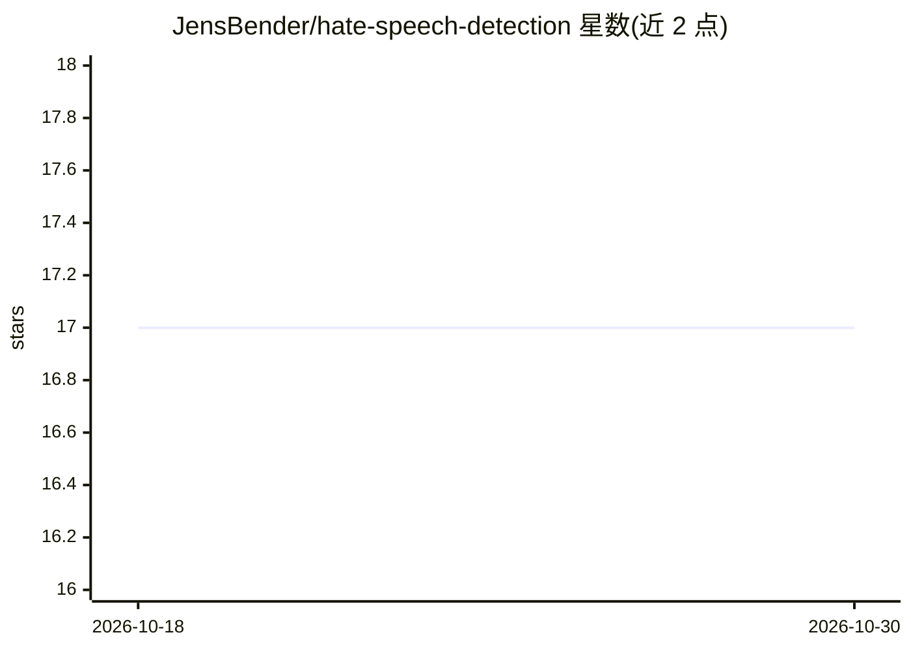

# JensBender/hate-speech-detection

⭐ 17 · PureBasic · MIT · 推送 2026-02-06 · [GitHub](https://github.com/JensBender/hate-speech-detection) · 个人维护

**面向社交媒体评论的 BERT 仇恨言论检测项目（含 Web 应用与 API 部署）**

个人深度学习项目：在 ETHOS 仇恨言论数据集（998 条 YouTube/Reddit 评论，43.4% 正例）上训练并对比 SimpleRNN、LSTM 与微调 BERT（TensorFlow Hub 小型 BERT，L-4_H-512_A-8）三种模型，微调 BERT 测试准确率 78.0%。模型通过 Flask Web 应用与 API 端点部署，支持文本输入并输出是否为仇恨言论的预测；API 用 Postman 测试与文档化。README 给出训练/部署所需的 Python 包清单与三组模型的完整架构、超参数附录，未给出安装命令。

## 筛选速览

| 维度 | 判定 | 备注 |
|---|---|---|
| AI 角色 | `ai-native` | 本体是模型或模型工具 |
| 许可风险 | `permissive` | MIT |
| 部署形态 | `None` |  |
| 模型依赖 | — | README 未给出锁定关系 |
| 硬件要求 | — | 无带数字的原话,不猜 |
| 安装摩擦 | `low` | 无编译、无系统依赖或容器化 |
| 成熟度 | — | 结构信号不足 |

## 能力要点

- 微调 BERT（TensorFlow Hub small BERT）在 ETHOS 数据集上达 78.0% 测试准确率
- SimpleRNN/LSTM/BERT 三模型对比，含完整分类报告与超参数附录
- Flask Web 应用与 API 端点两种部署形态
- 提供 .env + python-dotenv 的 Flask 密钥管理方式

## 适用场景

- 判断社交媒体评论是否包含仇恨言论
- 通过 API 将仇恨言论检测集成到其他应用
- 参考三模型对比与超参数设置做文本分类实验

## 场景标签

 · 领域:NLP/内容审核

## 证据(README 行号)

> L1: Implemented a hate speech detector for social media comments using deep learning. The fine-tuned BERT model achieved
> L121: Utilizing the Flask framework, HTML, and CSS, I created a web application with a user-friendly interface for users
> L126: I developed an API endpoint to enable integration with other applications or services by leveraging the Flask fram

## 星数曲线

2026-10-18 17 → 2026-10-30 17（+0）

---
*卡片 v1 · prompt 1.4 · 生成 2026-10-30 · 置信度 high · 依据 README sha `e338378ac00c` · [字段定义](../../DATASET.md)*
