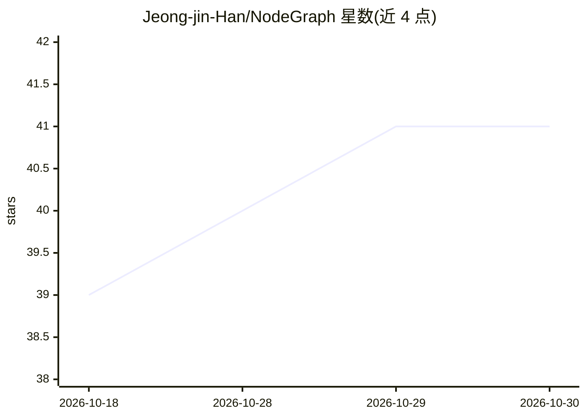

# Jeong-jin-Han/NodeGraph

⭐ 41 · TypeScript · MIT · 推送 2026-10-10 · [GitHub](https://github.com/Jeong-jin-Han/NodeGraph) · [官网](https://marketplace.visualstudio.com/items?itemName=JeongjinHan.nodegraph) · 个人维护 · 中文 README

**把研究论文转成可溯源知识图谱的 VS Code 扩展**

VS Code 扩展，提供节点图画布，把论文拆解为按 hop 层级自动布局的知识图谱。核心机制：随扩展附带机器可读规范 .agent/nodegraph/SPEC.md 与提示词，让 AI 代理（Claude Code、Codex、Cursor 等）直接读取 PDF 并生成/编辑 .nodegraph.json；也可无代理手动建图。节点内 Markdown 表格、KaTeX 公式与图片同卡渲染；每个声明可携带原文引用，点击跳转源 PDF 高亮对应句；配套 tools/verify-nodegraph.js 校验器复核引用并阻止代理伪造校验结果；支持导出单文件自包含 HTML。含 5 个代理构建的示例图谱。

## 筛选速览

| 维度 | 判定 | 备注 |
|---|---|---|
| AI 角色 | `ai-enhanced` | 去掉 AI 部分产品仍成立 |
| 许可风险 | `permissive` | MIT |
| 部署形态 | `library` | 以包/库形式分发 |
| 模型依赖 | — | README 未给出锁定关系 |
| 硬件要求 | — | 无带数字的原话,不猜 |
| 安装摩擦 | `low` | 无编译、无系统依赖或容器化 |
| 成熟度 | — | 结构信号不足 |

## 能力要点

- 每个声明携带原文引用，一键跳转源 PDF 高亮对应句
- 机器可读 SPEC.md 规范，AI 代理可直接读写图谱
- tools/verify-nodegraph.js 复核引用与链接，非零退出阻止伪造校验
- 节点内 GFM 表格、KaTeX 公式、图片同卡渲染，图谱导出单文件 HTML

## 适用场景

- 精读论文时把论证拆回其来源思路并逐条核对原文
- 让 AI 代理代建论文笔记图谱并核验其声明出处
- 导出自包含 HTML 在 VS Code 之外分享笔记

## 场景标签

`知识图谱` `科研工具` · 领域:知识与检索

## 证据(README 行号)

> L9: Point an AI agent (Claude Code, Codex, Cursor, Antigravity) at a PDF and it reads the paper and builds the whole gra
> L38: It's also built around **working with an agent rather than a mouse**. Hand-placing every node as you read is tediou
> L78: |**Agent-friendly**|A machine-readable spec (`.agent/nodegraph/SPEC.md`) so AI agents can read and write graphs dir

## 星数曲线

2026-10-18 39 → 2026-10-30 41（+2）

---
*卡片 v1 · prompt 1.4 · 生成 2026-10-25 · 置信度 mid · 依据 README sha `6dc0255a661b` · [字段定义](../../DATASET.md)*
