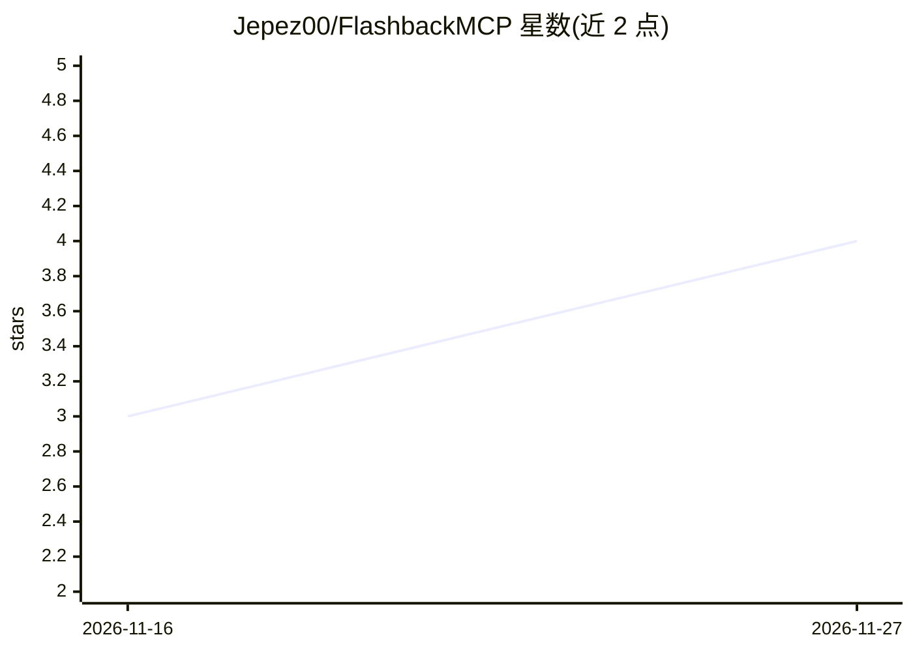

# Jepez00/FlashbackMCP

⭐ 4 · JavaScript · NOASSERTION · 推送 2026-11-04 · [GitHub](https://github.com/Jepez00/FlashbackMCP) · 个人维护

**让 AI 客户端操控 Minecraft Flashback 回放剪辑的本地 MCP 服务器**

本仓库是一个 Node.js 编写的 MCP 服务器（单个 .mjs 文件，22 个工具），通过 stdio 与本地 AI 客户端通信，再经本地 HTTP 连接到 Minecraft 的 Flashback MCP Fabric 模组，从而由 AI 助手控制回放播放、相机路径与关键帧编辑、视觉效果调整及视频导出。服务器本身不依赖 npm 包、无需自有模型 API key，模型与账号由用户的 AI 客户端管理；需在 Minecraft 同机同用户下运行，仅支持本地 stdio 客户端。提供英文与意大利文安装指南，代码许可为 All Rights Reserved。

## 筛选速览

| 维度 | 判定 | 备注 |
|---|---|---|
| AI 角色 | `ai-ecosystem` | LLM/agent 周边工具 |
| 许可风险 | `none` | NOASSERTION |
| 部署形态 | `desktop` | 安装包/桌面程序 |
| 模型依赖 | — | README 未给出锁定关系 |
| 硬件要求 | — | 无带数字的原话,不猜 |
| 安装摩擦 | `low` | 无编译、无系统依赖或容器化 |
| 成熟度 | — | 结构信号不足 |

## 能力要点

- 22 个 MCP 工具覆盖回放、相机、时间轴、导出等环节
- 单文件 .mjs 服务器，无 npm 依赖与构建步骤
- 自动读取 ~/.flashback-mcp/bridge.json 完成本地连接发现，无需配置端口或粘贴 token
- 提供 --print-config 为 Codex、Claude、Cursor、Gemini CLI、VS Code 等客户端生成配置

## 适用场景

- 用自然语言让 AI 助手在 Flashback 回放中编排相机镜头
- 对话式检查时间轴、预览帧并导出 Minecraft 电影视频
- 录制过程后由 AI 查找并打开最新回放进行剪辑

## 场景标签

 · 领域:游戏工具/AI 工具集成

## 证据(README 行号)

> L16: Flashback MCP connects an AI assistant to Flashback, the Minecraft replay editor. Describe the shot you want, inspe
> L18: This repository contains the **Node.js MCP server**. Install the companion Flashback MCP Fabric mod in Minecraft to
> L161: This release provides a **local stdio server**, not a public HTTP MCP endpoint. Browser-only/cloud clients and cli

## 星数曲线

2026-11-16 3 → 2026-11-27 4（+1）

---
*卡片 v1 · prompt 1.4 · 生成 2026-11-22 · 置信度 mid · 依据 README sha `7ef641cbf85d` · [字段定义](../../DATASET.md)*
