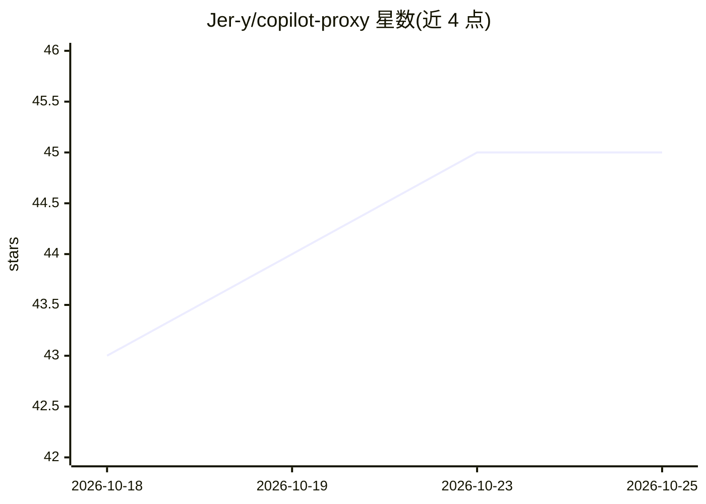

# Jer-y/copilot-proxy

⭐ 45 · TypeScript · MIT · 推送 2026-09-21 · [GitHub](https://github.com/Jer-y/copilot-proxy) · [官网](https://jer-y.github.io/copilot-proxy/) · 个人维护 · 中文 README

**将 GitHub Copilot 身份暴露为 OpenAI/Anthropic 兼容 API 的本地反向代理**

本地反向代理服务器，把一个或多个所有者配置的 GitHub Copilot 身份通过标准 OpenAI 与 Anthropic 兼容的 API 端点对外提供，支持 Claude Code、Codex 与 openai-sdk 的客户端接入配置。提供 OpenAI 兼容的 Chat Completions/Responses/Models/Embeddings、Anthropic 兼容的 Messages 与 token 计数、确定性多账号路由与诊断命令。要求 Copilot 订阅与 Node.js >= 22.19.0。项目为非官方逆向实现，Copilot 变更可能导致失效；仅支持原生协议，不做跨协议转换、账号负载均衡或自动故障转移；无下游用户认证，建议仅回环使用。

## 筛选速览

| 维度 | 判定 | 备注 |
|---|---|---|
| AI 角色 | `ai-ecosystem` | LLM/agent 周边工具 |
| 许可风险 | `permissive` | MIT |
| 部署形态 | `library` | 以包/库形式分发 |
| 模型依赖 | — | README 未给出锁定关系 |
| 硬件要求 | — | 无带数字的原话,不猜 |
| 安装摩擦 | `low` | 无编译、无系统依赖或容器化 |
| 成熟度 | — | 结构信号不足 |

## 能力要点

- OpenAI 兼容的 Chat Completions、Responses HTTP/SSE、Models 与 Embeddings 端点
- Anthropic 兼容的 Messages 与 token 计数
- 确定性多账号路由、客户端 setup 与 doctor 诊断
- 支持 Claude / Codex / openai-sdk 三种客户端配置

## 适用场景

- 让我用已有 Copilot 订阅驱动 Claude Code 或 Codex CLI
- 将 Copilot 身份接入需要 OpenAI 兼容 API 的本地工具
- 多账号场景下按确定性策略路由请求

## 场景标签

`模型网关` · 领域:Agent 开发

## 证据(README 行号)

> L5: A local reverse proxy that exposes one or more owner-configured GitHub Copilot identities through standard OpenAI- a
> L31: - OpenAI-compatible Chat Completions, Responses HTTP/SSE, Models, and Embeddings.

## 星数曲线

2026-10-18 43 → 2026-10-25 45（+2）

---
*卡片 v1 · prompt 1.4 · 生成 2026-10-25 · 置信度 high · 依据 README sha `430a1ec9bec0` · [字段定义](../../DATASET.md)*
