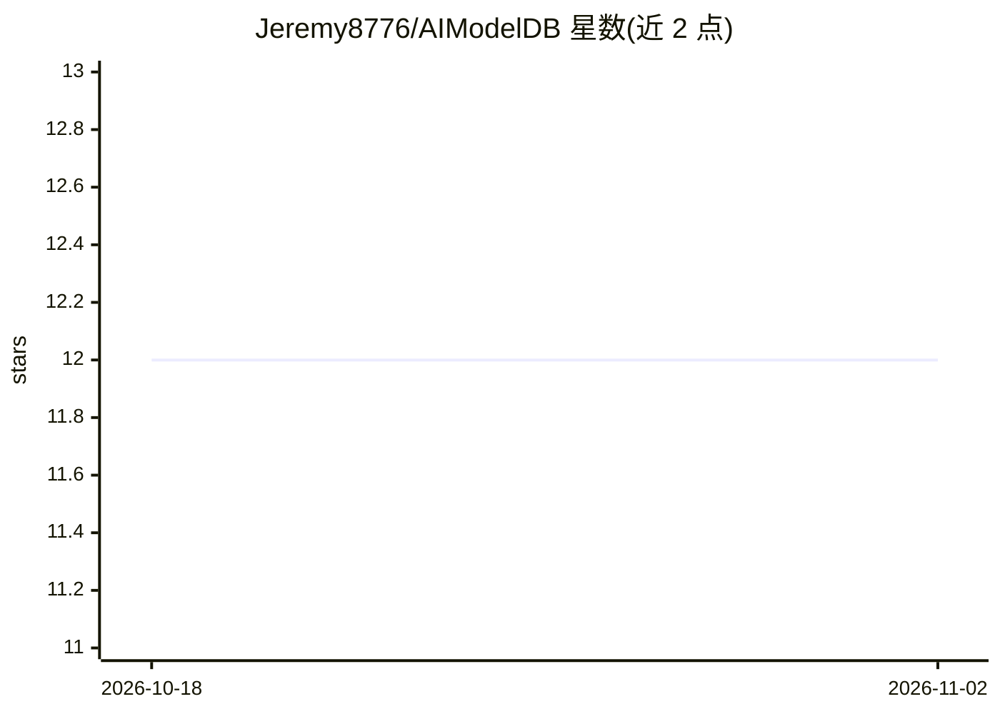

# Jeremy8776/AIModelDB

⭐ 12 · TypeScript · NOASSERTION · 推送 2026-11-01 · [GitHub](https://github.com/Jeremy8776/AIModelDB) · 个人维护

**桌面端 AI 模型聚合目录：多源同步、检索与元数据校验**

基于 Electron + React 的桌面应用，将 Hugging Face、Civitai、OpenModelDB、Artificial Analysis 等来源的模型元数据聚合到本地统一数据库，支持按领域、许可证、商用标签过滤，手动编辑在重新同步后保留。可调用 OpenAI/Anthropic/Google/DeepSeek API 校验并富化模型元数据，CJK 来源模型同步时经 Google Translate 自动译为英文。API 密钥本地加密存储；提供 Windows/macOS/Linux 安装包与源码构建流程。属 DataCert AI 三仓库本地栈的注册层。

## 筛选速览

| 维度 | 判定 | 备注 |
|---|---|---|
| AI 角色 | `ai-ecosystem` | LLM/agent 周边工具 |
| 许可风险 | `none` | NOASSERTION |
| 部署形态 | `desktop` | 安装包/桌面程序 |
| 模型依赖 | — | README 未给出锁定关系 |
| 硬件要求 | — | 无带数字的原话,不猜 |
| 安装摩擦 | `low` | 无编译、无系统依赖或容器化 |
| 成熟度 | — | 结构信号不足 |

## 能力要点

- 聚合 Hugging Face、Civitai、OpenModelDB 等多源模型元数据到统一数据库
- 可选调用 OpenAI/Anthropic/Google/DeepSeek 校验并富化模型元数据
- 手动编辑在同步后保留，API 密钥本地加密
- CJK 来源模型同步时经 Google Translate 自动译为英文，无需 API key

## 适用场景

- 在一个桌面应用里统一浏览多个模型站的模型目录
- 按许可证、商用许可、领域等条件筛选查找模型
- 对模型元数据做 AI 校验与人工整理

## 场景标签

 · 领域:AI 模型管理/桌面工具

## 证据(README 行号)

> L27: |**AI Model DB**|Registry and directory for models, providers, capabilities, MCP servers, skills, and install metad
> L38:  Aggregate AI models from Hugging Face, Civitai, and more into one unified database.

## 星数曲线

2026-10-18 12 → 2026-11-02 12（+0）

---
*卡片 v1 · prompt 1.4 · 生成 2026-11-01 · 置信度 high · 依据 README sha `f997ad90590f` · [字段定义](../../DATASET.md)*
