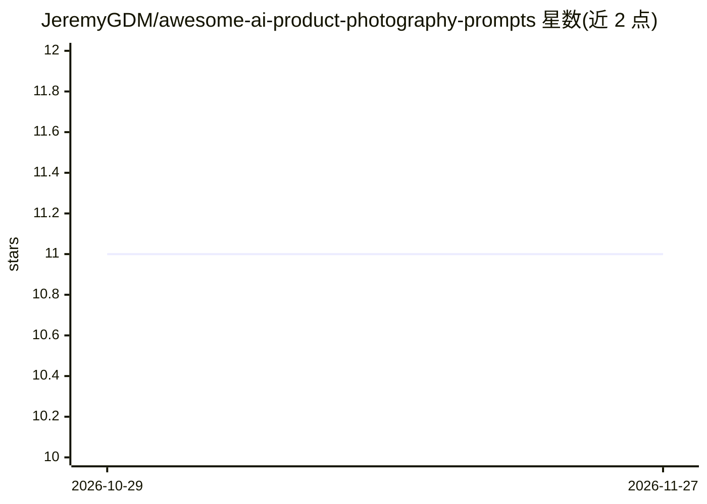

# JeremyGDM/awesome-ai-product-photography-prompts

⭐ 11 · CC0-1.0 · 推送 2026-08-09 · [GitHub](https://github.com/JeremyGDM/awesome-ai-product-photography-prompts) · [官网](https://pixonara.com) · 个人维护

**电商产品摄影 AI 提示词模板清单，可直接复制使用**

面向产品摄影场景的提示词模板集合，覆盖白底商品图、细节特写、生活方式场景、营销海报与产品图生视频广告。每条模板采用统一结构：先描述产品真实信息，再赋予图像单一任务，并要求发布前核对输出。模板声明兼容 GPT Image、Nano Banana（Gemini）、Midjourney 等图像模型，风格词可调整。仓库内附真实示例（含完整提示词）及按类目组织的 122 张图片画廊，完整提示词在仓库中镜像。

## 筛选速览

| 维度 | 判定 | 备注 |
|---|---|---|
| AI 角色 | `ai-knowledge` | 知识聚合/清单类 |
| 许可风险 | `viral` | CC0-1.0 |
| 部署形态 | `None` |  |
| 模型依赖 | — | README 未给出锁定关系 |
| 硬件要求 | — | 无带数字的原话,不猜 |
| 安装摩擦 | `low` | 无编译、无系统依赖或容器化 |
| 成熟度 | — | 结构信号不足 |

## 能力要点

- 白底商品图/细节特写/生活方式/海报/图生视频五类场景的模板
- 统一模板结构：产品真实信息优先、单一任务、发布前核对
- 附 122 张示例图片画廊，完整提示词在仓库内镜像
- 声明兼容 GPT Image、Nano Banana（Gemini）、Midjourney 等图像模型

## 适用场景

- 为电商商品列表页生成白底产品图提示词
- 制作带虚构品牌标签的生活方式场景营销图
- 为社交媒体广告寻找商业食品拍摄提示词参考
- 生成产品图到视频广告的提示词

## 场景标签

`提示工程` `图像生成` `精选清单` `视频生成` · 领域:Agent 开发

## 证据(README 行号)

> L3: > A curated collection of copy-paste prompt templates for AI product photography — white-background listings, detail
> L9: Every template below follows the same principle: **describe the product truth first, give the image one job, and rev

## 星数曲线

2026-10-29 11 → 2026-11-27 11（+0）

---
*卡片 v1 · prompt 1.4 · 生成 2026-11-19 · 置信度 high · 依据 README sha `7b246516afea` · [字段定义](../../DATASET.md)*
