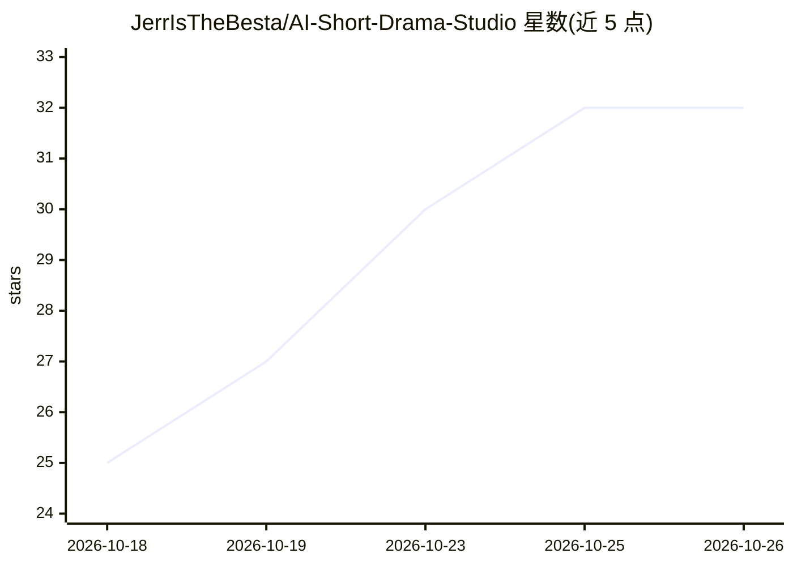

# JerrIsTheBesta/AI-Short-Drama-Studio

⭐ 32 · TypeScript · MIT · 推送 2026-10-24 · [GitHub](https://github.com/JerrIsTheBesta/AI-Short-Drama-Studio) · 个人维护 · 中文 README

**开源 AI 短剧创作工作台：剧本到成片的一站式生成**

基于 Vue 3 + Electron 的桌面端 AI 视频创作应用，把剧本、角色、场景、分镜、生图、视频、配音、音乐与剪辑合成放入统一可视化画布，由智能体推进或手动编辑，支持节点局部重做。各能力可接入 OpenAI 兼容接口、中转站、本地/云端 ComfyUI 或自定义接口，模型不绑定单一厂商；本地使用 FFmpeg.wasm 完成合成导出，项目数据默认存本地。Windows 提供安装包，源码运行需 Node.js 20+ 与 npm 10+。

## 筛选速览

| 维度 | 判定 | 备注 |
|---|---|---|
| AI 角色 | `ai-native` | 本体是模型或模型工具 |
| 许可风险 | `permissive` | MIT |
| 部署形态 | `desktop` | 安装包/桌面程序 |
| 模型依赖 | — | README 未给出锁定关系 |
| 硬件要求 | — | 无带数字的原话,不猜 |
| 安装摩擦 | `medium` | 含编译或系统依赖之一 |
| 成熟度 | — | 结构信号不足 |

## 能力要点

- 统一画布覆盖剧本→分镜→生图→视频→配音→剪辑全流程
- 语言/视觉/生图/视频/配音均可多套配置接入不同厂商、中转站或本地 ComfyUI
- 自然语言智能体可规划任务、创建与连接画布节点并支持失败续跑
- FFmpeg.wasm 本地完成拼接、混音、字幕烧录与导出

## 适用场景

- 用 AI 从一句想法生成完整短剧并导出成片
- 在可视化画布中对某个镜头局部重做而不重跑全项目
- 接入自己的 API/中转站或本地 ComfyUI 灵活组合各环节模型

## 场景标签

`图像生成` `视频生成` `语音合成` · 领域:内容生成

## 证据(README 行号)

> L12: 剧流 Studio 把剧本、角色、场景、分镜、图片、视频、配音、音乐和最终合成放进一张可视化画布。你可以让智能体推进完整创作，也可以随时修改节点、连接素材、替换模型或只重做其中一步。
> L14: 项目不绑定某一家 AI 服务。语言模型、视觉理解、生图、视频、配音和音乐都可以使用不同厂商、中转站、本地 ComfyUI 或自定义工作流。

## 星数曲线

2026-10-18 25 → 2026-10-26 32（+7）

---
*卡片 v1 · prompt 1.4 · 生成 2026-10-26 · 置信度 high · 依据 README sha `41631513979c` · [字段定义](../../DATASET.md)*
