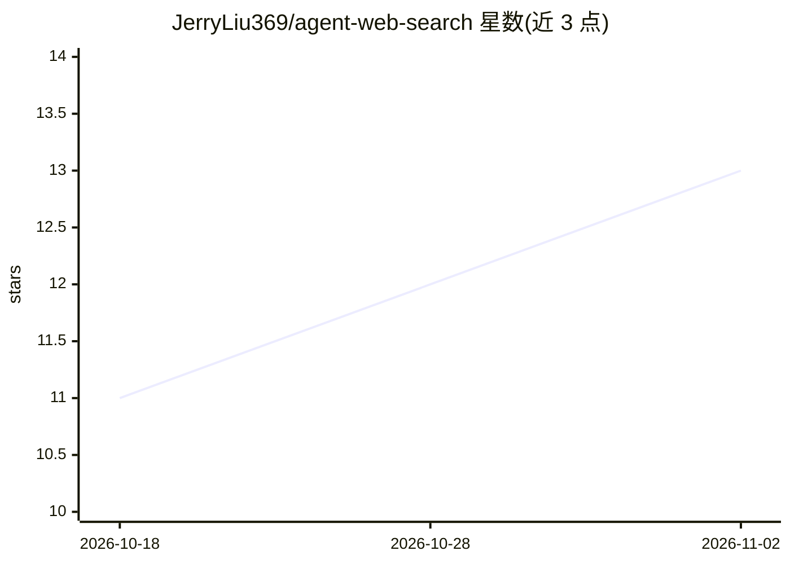

# JerryLiu369/agent-web-search

⭐ 13 · Python · MIT · 推送 2026-10-23 · [GitHub](https://github.com/JerryLiu369/agent-web-search) · [官网](https://pypi.org/project/agent-web-search-mcp/) · 个人维护 · 中文 README

**给 AI agent 的多源网页搜索工具：MCP/CLI/插件统一接入**

MIT 许可的网页搜索 MCP 服务器、CLI 与 Python 库（PyPI: agent-web-search-mcp），面向 AI agent 提供统一的中立搜索接口。聚合三类后端：模型原生 grounding（ARK、Gemini、Grok、DeepSeek、Responses 等）、面向 agent 的搜索 API（Exa、Parallel、Brave、Perplexity、Tavily 等）与传统 DDGS 后端；默认 DDGS/Exa/Parallel 免 API key。集成途径含 MCP（stdio/Streamable HTTP）、CLI+Agent Skill、DSH 与 Hermes 插件；需 Python 3.10+。

## 筛选速览

| 维度 | 判定 | 备注 |
|---|---|---|
| AI 角色 | `ai-ecosystem` | LLM/agent 周边工具 |
| 许可风险 | `permissive` | MIT |
| 部署形态 | `self-host` | docker 或自建部署 |
| 模型依赖 | — | README 未给出锁定关系 |
| 硬件要求 | — | 无带数字的原话,不猜 |
| 安装摩擦 | `low` | 无编译、无系统依赖或容器化 |
| 成熟度 | — | 结构信号不足 |

## 能力要点

- 统一 provider 中立契约：所有后端经同一 MCP 工具/CLI/Python API 输出规范化 results
- 默认 DDGS、Exa、Parallel 三家免 API key 即可用
- 支持本地 stdio 与远程 Streamable HTTP MCP 两种部署
- 提供 CLI + Agent Skill 集成路径，无需 MCP 配置

## 适用场景

- 给 Claude Code / Codex CLI 等 agent 接入网页搜索能力
- 通过自然语言问题获取带引用的结构化检索证据
- 在无 API key 环境下为 agent 提供开箱即用的搜索后端

## 场景标签

`语义搜索` · 领域:知识与检索

## 证据(README 行号)

> L27: Agent Web Search (PyPI: `agent-web-search-mcp`) is an open-source,
> L29: gives an agent three ways to reach the same provider-neutral search core: a

## 星数曲线

2026-10-18 11 → 2026-11-02 13（+2）

---
*卡片 v1 · prompt 1.4 · 生成 2026-11-01 · 置信度 mid · 依据 README sha `2934ef0f5fdf` · [字段定义](../../DATASET.md)*
