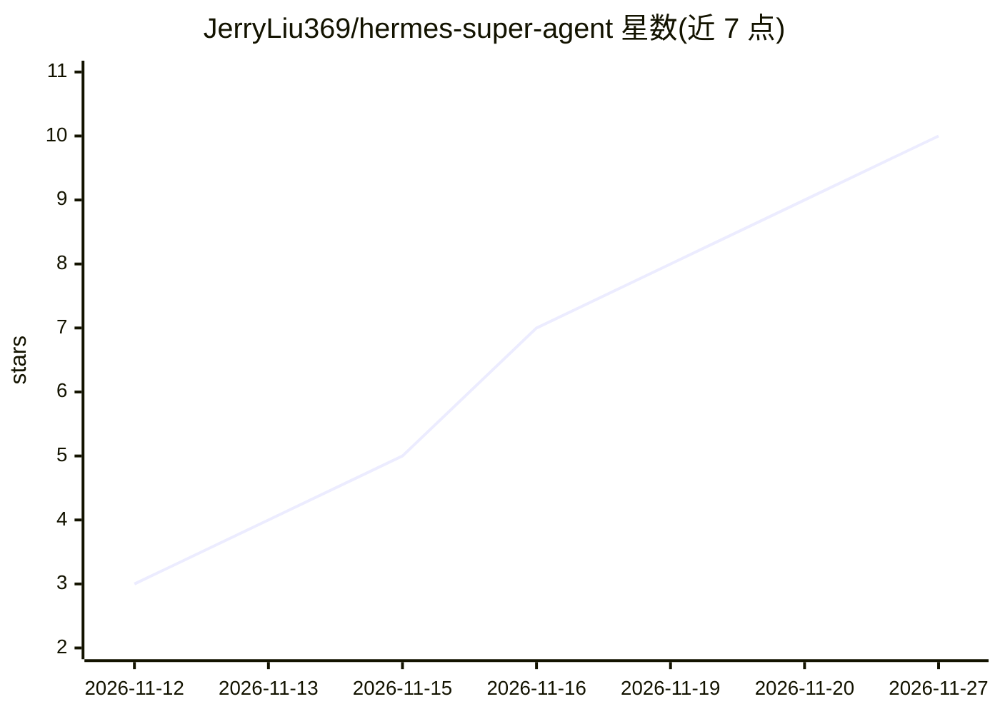

# JerryLiu369/hermes-super-agent

⭐ 10 · Python · MIT · 推送 2026-11-19 · [GitHub](https://github.com/JerryLiu369/hermes-super-agent) · 个人维护

**Hermes Agent 插件：把聊天助手调度成主 agent 加后台 subagents 团队**

面向 Hermes Agent 的插件，让一个聊天助手像秘书带工人一样运作：主 agent 在聊天中保持响应，后台 subagents 处理耗时工作。机制包括主 agent 回合时间预算（60 秒提醒、120 秒暂停编辑与命令）、delegation 简报注入（上下文长度检查、记忆文件复制、运行中任务摘要）、subagent 循环检测（同参数同结果第 3 次警告、第 5 次停止）与 needs_decision 结构化报告；结果需核验后交付并记录到 ledger.db。插件本身不调用模型、不直接写聊天消息，以 Python 实现，通过 hermes plugins install 安装。

## 筛选速览

| 维度 | 判定 | 备注 |
|---|---|---|
| AI 角色 | `ai-ecosystem` | LLM/agent 周边工具 |
| 许可风险 | `permissive` | MIT |
| 部署形态 | `None` |  |
| 模型依赖 | — | README 未给出锁定关系 |
| 硬件要求 | — | 无带数字的原话,不猜 |
| 安装摩擦 | `low` | 无编译、无系统依赖或容器化 |
| 成熟度 | — | 结构信号不足 |

## 能力要点

- 主 agent 回合时间预算：60 秒提醒、120 秒暂停编辑与前台命令
- subagent 简报注入：最近消息、USER.md/MEMORY.md、运行中任务与工作规则
- 工具调用循环检测：同结果第 3 次警告、第 5 次停止并要求报 blocked
- needs_decision 报告：subagent 遇非其权限决策时提问而非猜测

## 适用场景

- 在消息应用中与 Hermes 对话时保持聊天不因长任务而沉默
- 多 subagent 并行修改文件时避免互相覆盖
- 后台长任务的结果核验后按时送达聊天

## 场景标签

`多智能体` · 领域:Agent 开发

## 证据(README 行号)

> L5: Hermes plugin
> L11: A plugin for Hermes Agent that turns one chat assistant into a small team, like a good secretary with workers behin
> L13: Built for talking to Hermes from a messaging app, the plugin runs as plain Python code. It makes no model calls of 

## 星数曲线

2026-11-12 3 → 2026-11-27 10（+7）

---
*卡片 v1 · prompt 1.4 · 生成 2026-11-20 · 置信度 high · 依据 README sha `d41f41396160` · [字段定义](../../DATASET.md)*
