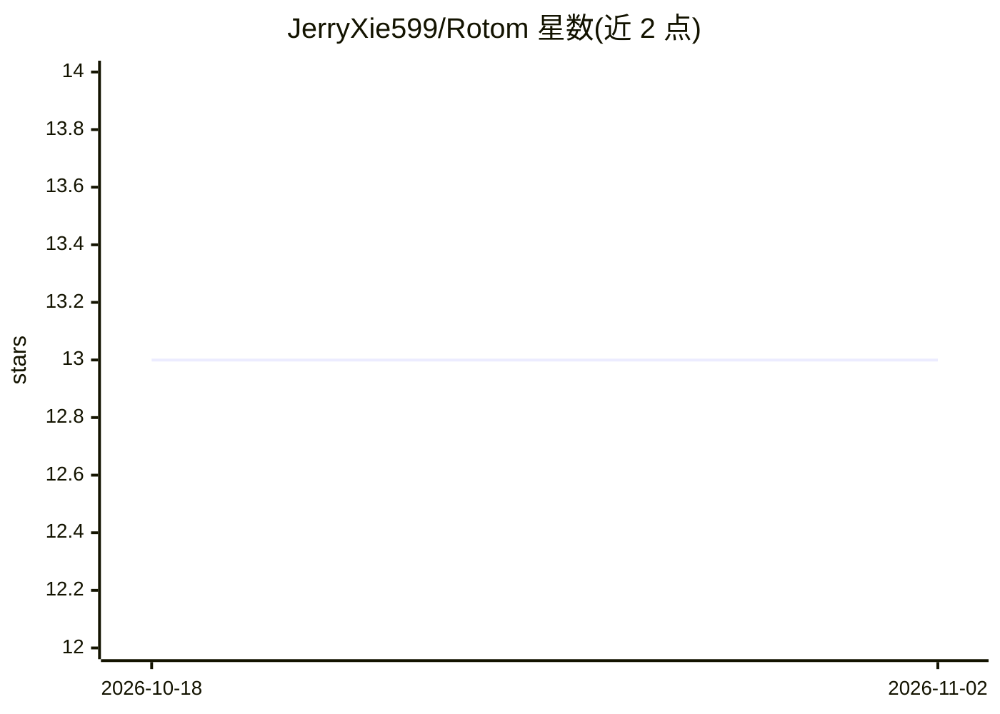

# JerryXie599/Rotom

⭐ 13 · Python · 推送 2026-10-28 · [GitHub](https://github.com/JerryXie599/Rotom) · 个人维护 · 中文 README

**CTF 比赛自动化解题 Agent harness：调度多 agent 并发答题**

面向 AI 智能体解题赛的轻量 harness：调度层负责派题、并发、限流退避、重试与对账，每题派一个隔离 agent（基于 pi CLI），agent 之间通过共享黑板与方向知识库协同。模型不绑定，现场在网页控制台填写 Base URL/Key/模型名即可切换，支持 OpenAI 兼容、Anthropic、Google 四种 API 类型。附离线知识库（9000+ 段）、看护自愈、赛后复盘与轨迹导出工具。需 Linux 环境的题（pwn/web）依赖 OrbStack/WSL2 等方案。

## 筛选速览

| 维度 | 判定 | 备注 |
|---|---|---|
| AI 角色 | `ai-native` | 本体是模型或模型工具 |
| 许可风险 | `none` | — |
| 部署形态 | `None` |  |
| 模型依赖 | — | README 未给出锁定关系 |
| 硬件要求 | — | 无带数字的原话,不猜 |
| 安装摩擦 | `low` | 无编译、无系统依赖或容器化 |
| 成熟度 | — | 结构信号不足 |

## 能力要点

- 调度层管派题/并发/重试/对账，每题一个隔离 agent
- 同题多 agent 通过共享黑板协同，可请求增援（每题上限 4）
- 9000+ 段离线知识库，检索 0.2s，四层机制保证注入 prompt
- 支持 OpenAI 兼容/Anthropic/Google 四种 API 类型，控制台热切换

## 适用场景

- 在 CTF 比赛中让多个 agent 并发自动解题与提交
- 赛后导出解题轨迹做复盘与审计
- 本地用压测脚本验证调度与并发能力

## 场景标签

`多智能体` `网络安全` · 领域:Agent 开发

## 证据(README 行号)

> L12: 参考 Cairn 的黑板架构,为「AI 智能体解题赛」打造的轻量 harness:
> L13: **调度层只管派题、并发、重试、对账;每题一个隔离 agent**(`pi` CLI)自带工作区、共享黑板与方向知识库;
> L34: 现场三步:控制台填 **token + 模型四项**(Base URL / Key / 模型名 / API 类型)→ 点「测试接口」「测试模型」→ 「开始跑」。

## 星数曲线

2026-10-18 13 → 2026-11-02 13（+0）

---
*卡片 v1 · prompt 1.4 · 生成 2026-10-31 · 置信度 high · 依据 README sha `e7f58fed584e` · [字段定义](../../DATASET.md)*
