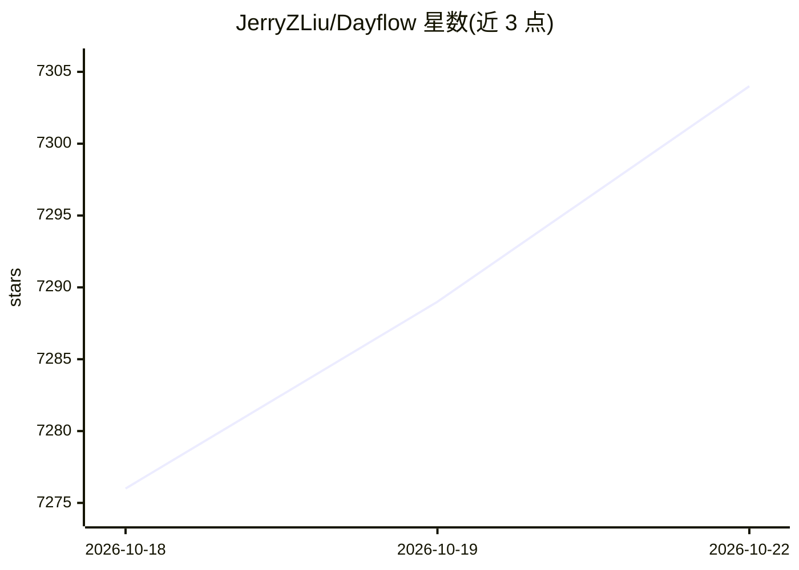

# JerryZLiu/Dayflow

⭐ 7,304 · Swift · MIT · 推送 2026-10-21 · [GitHub](https://github.com/JerryZLiu/Dayflow) · [官网](https://www.dayflow.so/) · 个人维护

**Mac 上的自动化工作日志：用 AI 把屏幕活动变成时间线**

本地优先的 macOS 桌面应用：在后台捕获轻量屏幕片段，交由用户选择的 AI 提供商分析，生成按时间排列的活动卡片，无需手动计时或记录。功能包括每日站会要点、每周回顾、分心追踪、时间线 Markdown 导出，以及基于时间线的自然语言问答。默认所有录制与数据保存在本机，可选本地模型（Ollama/LM Studio）或 Gemini/ChatGPT/Claude 做分析。要求 macOS 14+ 并授予屏幕录制权限，提供 DMG 下载、Homebrew 安装与 Xcode 源码构建三种方式。

## 筛选速览

| 维度 | 判定 | 备注 |
|---|---|---|
| AI 角色 | `ai-enhanced` | 去掉 AI 部分产品仍成立 |
| 许可风险 | `permissive` | MIT |
| 部署形态 | `desktop` | 安装包/桌面程序 |
| 模型依赖 | local-ok | 支持本地模型 |
| 硬件要求 | — | 无带数字的原话,不猜 |
| 安装摩擦 | `low` | 无编译、无系统依赖或容器化 |
| 成熟度 | — | 结构信号不足 |

## 能力要点

- 屏幕活动自动生成时间线活动卡片，无需计时器
- AI 提供商可选：本地 Ollama/LM Studio 或 Gemini/ChatGPT/Claude
- 本地优先存储，录制与数据库默认保存在 Mac 上
- 每日站会、每周回顾、分心追踪与 Markdown 导出

## 适用场景

- 我想自动记录每天做了什么，不用手动计时
- 站会前快速拿到昨天要点、今日计划与阻塞项
- 回顾一周的时间分布与分心情况

## 场景标签

 · 领域:生产力工具/时间追踪

## 证据(README 行号)

> L46: |Automatic timeline|Dayflow captures lightweight screen chunks, analyzes them with your chosen AI provider, and tur
> L54: |AI provider choice|Use local models, Gemini, ChatGPT, or Claude depending on your privacy and quality needs.|You c
> L75: - Local models through Ollama or LM Studio

## 星数曲线

2026-10-18 7,276 → 2026-10-22 7,304（+28）

---
*卡片 v1 · prompt 1.4 · 生成 2026-10-20 · 置信度 high · 依据 README sha `7a9ca5614d5f` · [字段定义](../../DATASET.md)*
