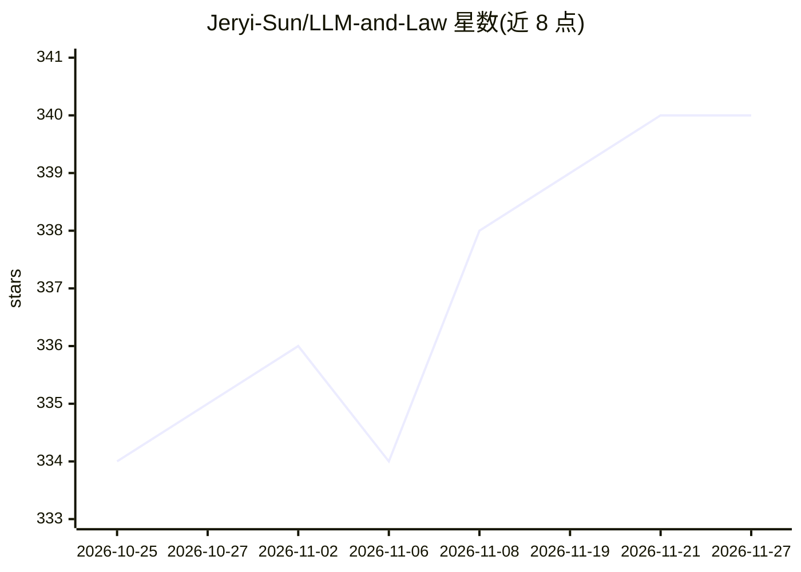

# Jeryi-Sun/LLM-and-Law

⭐ 340 · 推送 2026-11-24 · [GitHub](https://github.com/Jeryi-Sun/LLM-and-Law) · 个人维护

**法律领域大模型论文与资源的日更追踪清单**

以 Awesome 清单形式追踪法律领域与 LLM 相关的论文与资源，按 Applications、Legal Reasoning Models、Legal Agent、Legal Problems、Data Resources、Law LLMs、Evaluation 等类别组织条目。维护者每日扫描 arXiv cs.CL 日期列表，按法律相关性筛选并对条目附收录理由与排除说明，记录各类目增量。MIT 许可。面向关注 LLM 与法律交叉研究的读者。

## 筛选速览

| 维度 | 判定 | 备注 |
|---|---|---|
| AI 角色 | `ai-knowledge` | 知识聚合/清单类 |
| 许可风险 | `permissive` | — |
| 部署形态 | `None` |  |
| 模型依赖 | — | README 未给出锁定关系 |
| 硬件要求 | — | 无带数字的原话,不猜 |
| 安装摩擦 | `low` | 无编译、无系统依赖或容器化 |
| 成熟度 | — | 结构信号不足 |

## 能力要点

- 每日扫描 arXiv cs.CL 日期列表并做标题去重收录
- 按法律子任务类别（应用/推理模型/Agent/数据资源/评测等）组织条目
- 每条更新附收录理由、限制说明与排除范围

## 适用场景

- 查找法律领域 LLM 相关的最新论文
- 跟踪法律 NLP 各子方向（推理、Agent、评测、数据资源）的研究增量
- 了解某篇法律 LLM 论文的适用范围与局限说明

## 场景标签

`精选清单` · 领域:学习与行业

## 证据(README 行号)

> L5: This repository tracks papers and resources about large language models (LLMs) in the legal domain.
> L7: > Daily update 2026-11-24 (cs.CL): scanned all 204 papers on the dated list; added 6 title-deduplicated papers on CS

## 星数曲线

2026-10-25 334 → 2026-11-27 340（+6）

---
*卡片 v1 · prompt 1.4 · 生成 2026-11-26 · 置信度 high · 依据 README sha `72f41ff9841a` · [字段定义](../../DATASET.md)*
