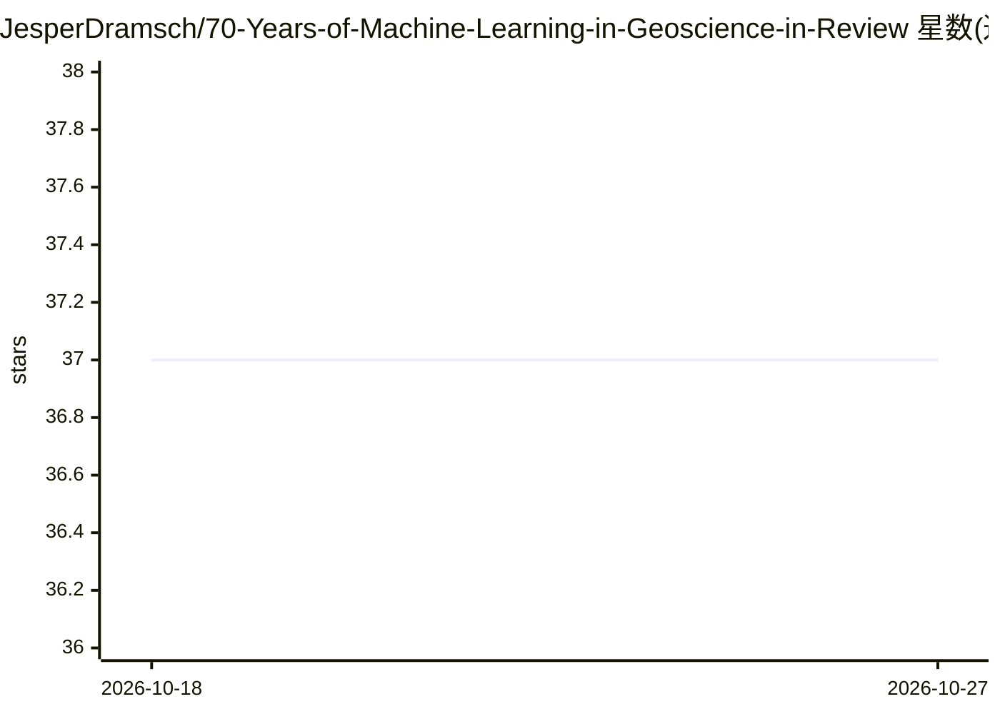

# JesperDramsch/70-Years-of-Machine-Learning-in-Geoscience-in-Review

⭐ 37 · HTML · MIT · 推送 2026-10-12 · [GitHub](https://github.com/JesperDramsch/70-Years-of-Machine-Learning-in-Geoscience-in-Review) · 个人维护

**地球科学机器学习综述章节的教程与图表复现代码**

配套书章《70 Years of Machine Learning in Geoscience in Review》的可复现研究代码仓库：提供两个 Jupyter notebook，Book_Examples.ipynb 包含章节教程与可视化结果，Book_Visualizations.ipynb 程序化生成章节插图；生成的图存放于 figures/ 目录，3D 决策边界体数据存储于外部 figshare（SVM、随机森林与深度神经网络对比）。预印本发布于 arXiv。README 未给出安装或运行命令。

## 筛选速览

| 维度 | 判定 | 备注 |
|---|---|---|
| AI 角色 | `ai-knowledge` | 知识聚合/清单类 |
| 许可风险 | `permissive` | MIT |
| 部署形态 | `None` |  |
| 模型依赖 | — | README 未给出锁定关系 |
| 硬件要求 | — | 无带数字的原话,不猜 |
| 安装摩擦 | `low` | 无编译、无系统依赖或容器化 |
| 成熟度 | — | 结构信号不足 |

## 能力要点

- 两个 notebook 覆盖章节教程与程序化生成插图
- 涵盖 SVM、随机森林与深度神经网络的决策边界可视化
- 3D 决策体数据托管于 figshare（DOI 可引用）

## 适用场景

- 复现综述章节中的教程与图表
- 作为地球科学机器学习教学参考材料
- 查阅决策边界可视化方法的实现代码

## 场景标签

`教程课程` · 领域:学习与行业

## 证据(README 行号)

> L2: Code to recreate the tutorial and figures in the book chapter.
> L8: Book_Examples.ipynb contains the tutorials and resulting visualizations of the chapter.

## 星数曲线

2026-10-18 37 → 2026-10-27 37（+0）

---
*卡片 v1 · prompt 1.4 · 生成 2026-10-25 · 置信度 high · 依据 README sha `02510851f4b8` · [字段定义](../../DATASET.md)*
