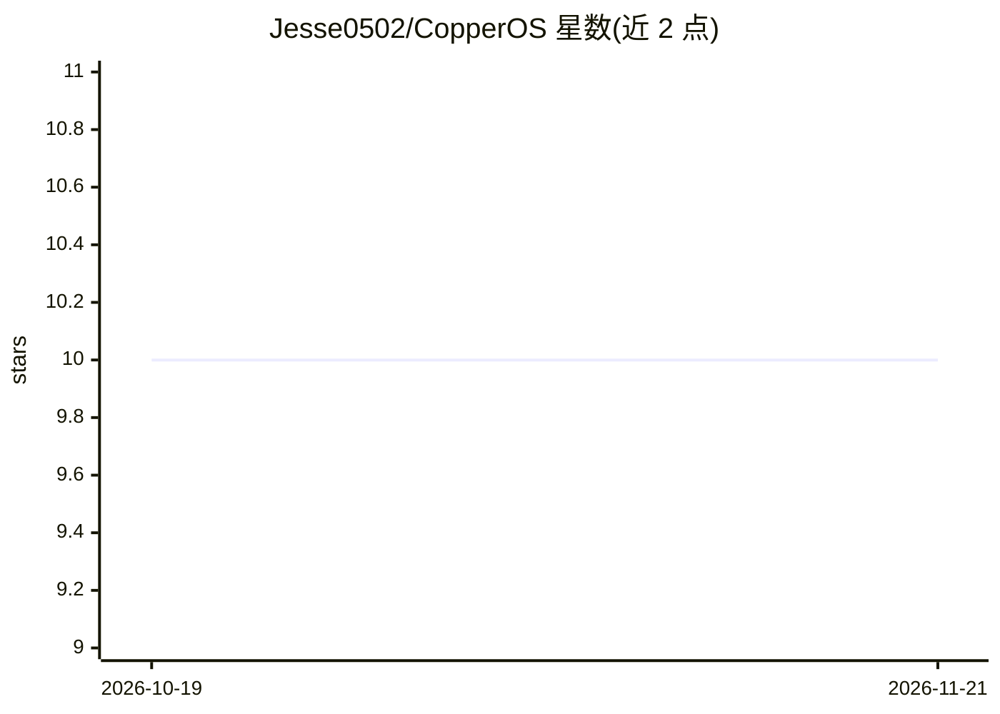

# Jesse0502/CopperOS

⭐ 10 · TypeScript · MIT · 推送 2026-11-13 · [GitHub](https://github.com/Jesse0502/CopperOS) · [官网](https://copper.jassydev.com) · 个人维护

**给 Chrome 用户的 agentic 浏览器助手：代你读取、点击、填写网页**

Chrome 扩展加本地 broker 的浏览器任务代理：用户在侧栏输入任务，代理在自己已登录的标签页中读取、点击、输入，每步在面板可见，提交前请求确认。感知以可访问性树为主，不可靠时自动升级为带标记的截图；输入经 CDP 发出。模型通过 Ollama、OpenRouter 或 OpenAI 接入，也可使用官方托管模型（Google 登录、每周免费额度）。需 Node.js 20+ 与支持 tool calling 的模型；vision 为可选能力。

## 筛选速览

| 维度 | 判定 | 备注 |
|---|---|---|
| AI 角色 | `ai-native` | 本体是模型或模型工具 |
| 许可风险 | `permissive` | MIT |
| 部署形态 | `library` | 以包/库形式分发 |
| 模型依赖 | local-ok | 支持本地模型 |
| 硬件要求 | — | 无带数字的原话,不猜 |
| 安装摩擦 | `low` | 无编译、无系统依赖或容器化 |
| 成熟度 | — | 结构信号不足 |

## 能力要点

- 可访问性树优先感知，快照约 2–5KB，不可靠时自动升级截图
- CDP 驱动输入，动作后回报页面差异（+/~/-），支持并行 tool call
- Google Sheets 场景提供 sheet_read/write/select 专用工具
- 支持任务循环（loop）、检查点（check-in）与 APPROVAL_MODE 三档审批

## 适用场景

- 让代理完成网页上的重复操作如填表、检索比价
- 在 Google Sheets 中批量读写单元格数据
- 长时间循执行任务并定期检查点汇报进展

## 场景标签

`浏览器自动化` · 领域:效率与自动化

## 证据(README 行号)

> L3: **The CopperOS browser agent for Chrome is open source.** You type a task in a side
> L39: You need Node.js 20 or newer and a model that supports **tool calling** — an
> L12: key needed), or on your own computer with the model you choose: Ollama,

## 星数曲线

2026-10-19 10 → 2026-11-21 10（+0）

---
*卡片 v1 · prompt 1.4 · 生成 2026-11-20 · 置信度 high · 依据 README sha `7e3943c93cd9` · [字段定义](../../DATASET.md)*
