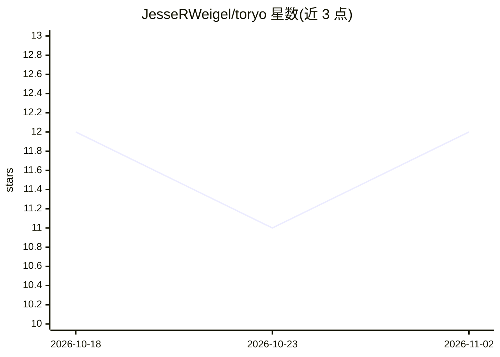

# JesseRWeigel/toryo

⭐ 12 · TypeScript · MIT · 推送 2026-09-09 · [GitHub](https://github.com/JesseRWeigel/toryo) · 个人维护

**编排多个 AI 编码 agent 的 TypeScript 编排器：委派/质检/自改进循环**

棟梁 Toryo 是面向开发者的 CLI 编排器，将 Claude Code、Aider、Gemini CLI、Codex、Ollama 等多种 AI 编码 agent 串入 Plan→Research→Execute→Review 四阶段循环。核心机制：基于滚动评分的信任委派（supervised/guided/autonomous 三级）、质量棘轮（评分达标才 git commit，否则 revert 并走 Ralph Loop 重试）、结构化 JSON 审查门（必须引用证据 ID，缺项即拒收）、实时 WebSocket 仪表盘与 results.tsv 记录。以 npm 包分发，TypeScript monorepo 结构，可只用其委派/棘轮等子模块。限制：未配置确定性 checks 时仅依赖模型审查；check 命令视为可信本地代码、不做沙箱。

## 筛选速览

| 维度 | 判定 | 备注 |
|---|---|---|
| AI 角色 | `ai-ecosystem` | LLM/agent 周边工具 |
| 许可风险 | `permissive` | MIT |
| 部署形态 | `library` | 以包/库形式分发 |
| 模型依赖 | local-ok | 支持本地模型 |
| 硬件要求 | — | 无带数字的原话,不猜 |
| 安装摩擦 | `low` | 无编译、无系统依赖或容器化 |
| 成熟度 | — | 结构信号不足 |

## 能力要点

- 7 种 agent 适配器（claude-code/aider/gemini-cli/ollama/codex/cursor/cline）+ 通用自定义适配器
- 信任分级委派：agent 通过滚动均分挣得 autonomous 权限，可被降级
- 质量棘轮：评分低于阈值即 git revert，Ralph Loop 携 QA 反馈重试
- 结构化审查门：单 JSON 对象、证据 ID 引用、缺失/冲突字段 fail closed

## 适用场景

- 把多个 AI 编码 CLI 工具组成流水线自动跑任务 spec
- 让本地 Ollama 承担代码生成、Claude Code 做研究的异构组合
- 通过 Web 仪表盘监控多 agent 状态、评分与成功率

## 场景标签

`多智能体` `编码 Agent` · 领域:Agent 开发

## 证据(README 行号)

> L12: Toryo chains multiple AI coding agents (Claude Code, Aider, Gemini CLI, Codex, Ollama) with spec-driven workflows, 
> L106: Toryo ships with first-class adapters for 7 tools + a generic adapter for anything else:
> L208: Toryo is a composable TypeScript monorepo. Use the full orchestrator or individual pieces:

## 星数曲线

2026-10-18 12 → 2026-11-02 12（+0）

---
*卡片 v1 · prompt 1.4 · 生成 2026-11-02 · 置信度 high · 依据 README sha `9812cb08ecd0` · [字段定义](../../DATASET.md)*
